# VulnScan AI & Model Architecture

## 1. Purpose

VulnScan uses AI as one component of a broader security-analysis pipeline.

The AI architecture is built around stable provider contracts, so model implementations can evolve independently from:

- Scan orchestration
- Finding correlation
- APIs
- Database models
- Frontend workflows
- Explainability
- Remediation
- Verification

---

## 2. AI Architecture

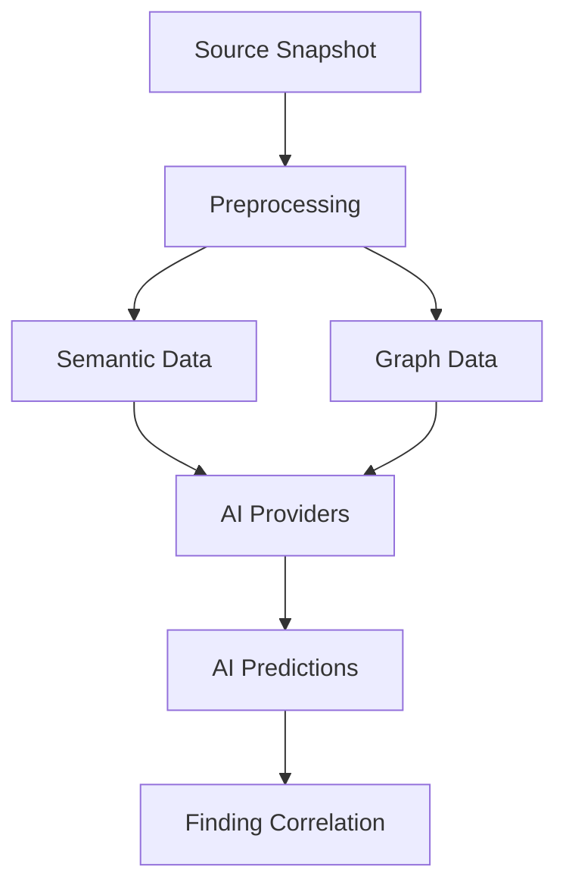

---

## 3. Provider Boundary

The application communicates with models through provider contracts.

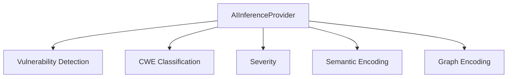

The scan pipeline consumes canonical outputs rather than model-specific objects.

---

## 4. Canonical AI Prediction

AI predictions are persisted with provenance. A prediction can contain:

- Organization
- Project
- Scan
- Source snapshot
- Function
- Source location
- Prediction
- Confidence
- CWE
- Severity
- CVSS
- Provider
- Model
- Model version
- Schema version
- Evidence

This allows later investigation of which model produced a prediction.

---

## 5. Model Architecture

The intended detection architecture combines semantic and graph information.

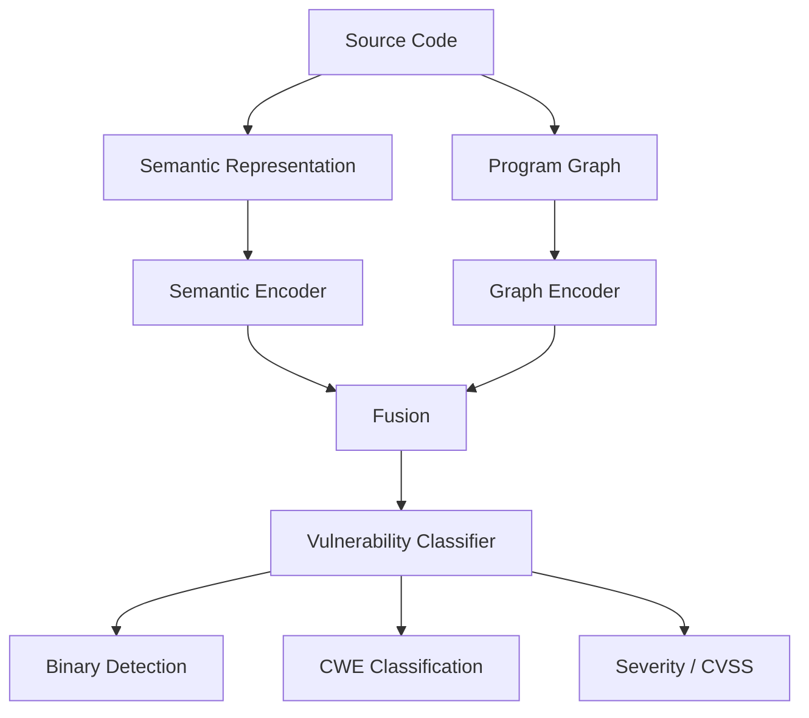

---

## 6. Semantic Models

The architecture supports code-language models such as:

- CodeBERT-family models
- GraphCodeBERT-family models
- Other compatible semantic encoders

The semantic model converts source and code context into representations that downstream classification can consume.

---

## 7. Graph Models

The graph side can use graph neural network architectures such as:

- GCN
- GAT
- GraphSAGE
- GIN

The graph representation is derived from program-analysis artifacts. Potential graph inputs include:

- AST
- CFG
- CPG
- Call graph
- Data flow
- PDG (where available)

---

## 8. Feature Fusion

Semantic and graph representations can be combined before classification.

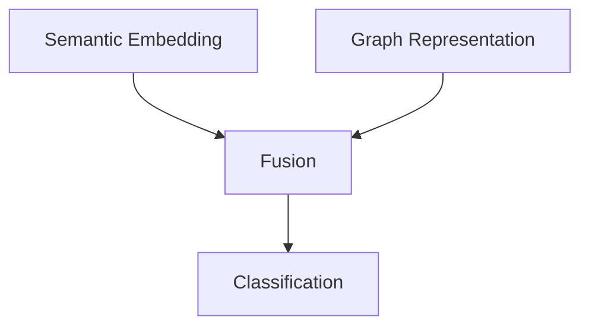

Fusion is isolated from the rest of the application.

---

## 9. Vulnerability Detection

The vulnerability detector produces a normalized prediction.

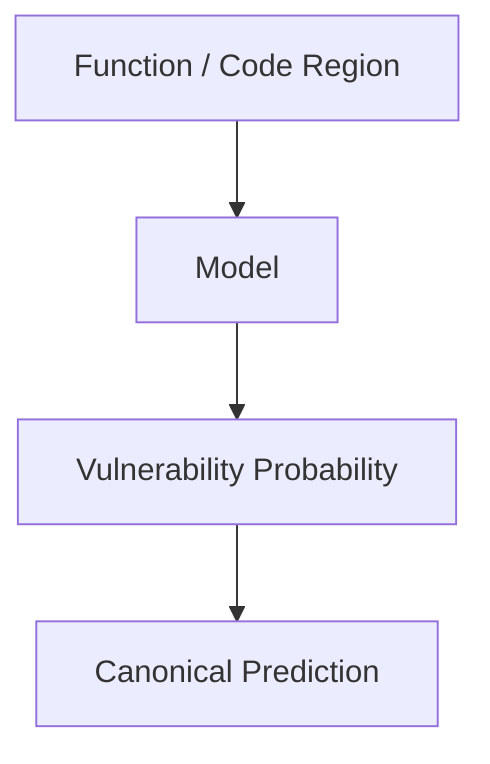

The prediction becomes one evidence source for the finding engine. It does not automatically become an authoritative finding without correlation.

---

## 10. CWE Classification

The CWE layer associates detected vulnerability behavior with a weakness category. The result can include:

- CWE identifier
- Confidence
- Model
- Version
- Source location
- Evidence

CWE classification remains part of the AI prediction provenance.

---

## 11. Severity and CVSS

Severity information can be produced or normalized through the AI and domain pipeline. The application stores the resulting values with their provenance.

Security posture calculations should use normalized persisted values rather than recomputing model outputs in the frontend.

---

## 12. Model Registry

Model versions are tracked independently from the finding domain. A model version can contain:

- Model identifier
- Version
- Provider
- Artifact reference
- Checksum
- Runtime requirements
- Status
- Metadata
- Creation time

This supports reproducibility and model lifecycle management.

---

## 13. Model Integrity

Model artifacts are security-sensitive. Where integrity verification is required, the system can validate them as follows:

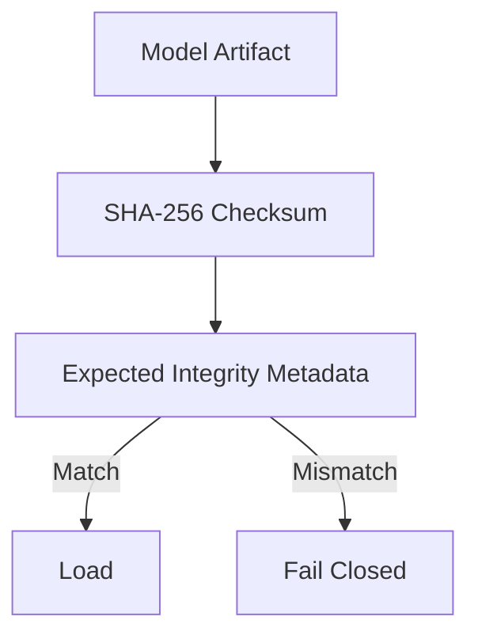

A model must not be silently replaced with an unexpected artifact.

---

## 14. Model Loading

Model loading should be isolated from API request handling. The provider is responsible for:

- Loading model artifacts
- Validating model integrity
- Initializing runtime dependencies
- Managing inference resources
- Reporting readiness
- Returning structured failures

---

## 15. Provider Failure States

AI availability is explicit. Possible states include:

- `AVAILABLE`
- `UNAVAILABLE`
- `MODEL_NOT_READY`
- `FAILED`
- `TIMEOUT`
- `UNSUPPORTED`

These states must remain visible to the application. The system must not turn a failed AI invocation into a fabricated prediction.

---

## 16. Inference Controls

Inference should be bounded by:

- Timeout
- Batch size
- Memory limits
- Input limits
- Output limits
- Worker resource limits

Large or malformed inputs must not be able to exhaust the API process.

---

## 17. AI Evidence

AI predictions can be correlated with:

- Source location
- Function
- Static evidence
- Taint evidence
- Graph evidence

The resulting finding retains references to the evidence used during correlation.

---

## 18. Explainability Boundary

XAI is a separate capability.

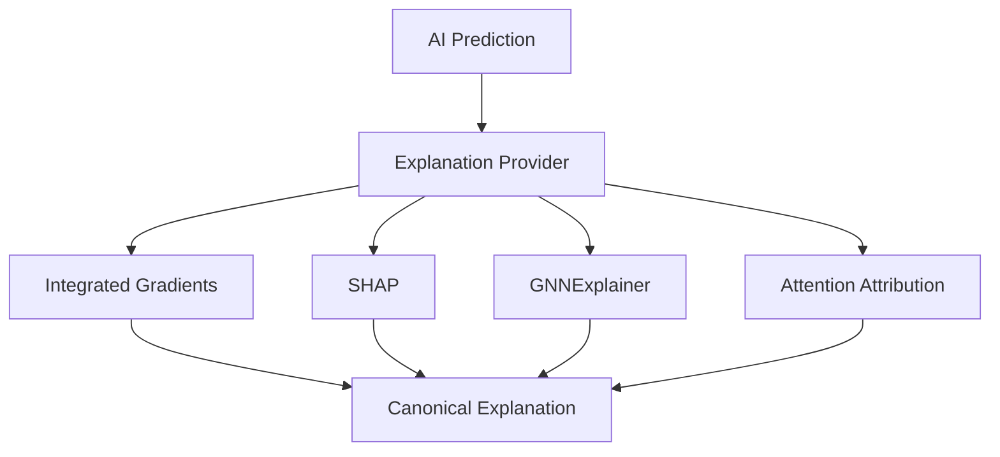

The explanation service does not replace the prediction service.

---

## 19. Remediation Boundary

Remediation models are separated from detection models.

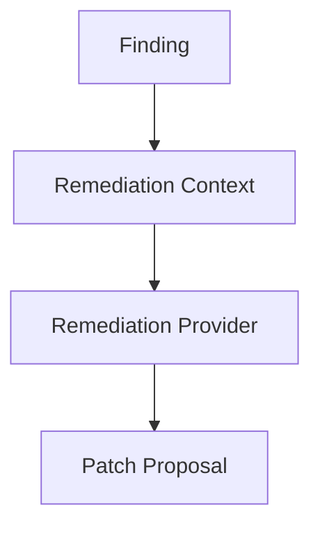

This prevents a vulnerability detector from being coupled to a specific code-generation model.

---

## 20. AI Trust Boundary

The AI system is never the final authority for:

- Tenant access
- Permissions
- Finding lifecycle
- Patch approval
- Verification
- Security gates
- Organization state

AI output is data consumed by trusted application logic.

---

## 21. Prompt Injection Boundary

Repository content may contain text that attempts to manipulate an AI system. Examples include:

- Comments
- Documentation
- Strings
- Test fixtures
- Configuration
- Source files
- User-controlled metadata

These are treated as untrusted data. The AI context must preserve the separation between:

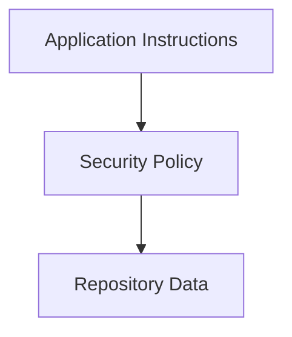

Repository content cannot override application-level instructions.

---

## 22. Provenance

Every model-driven result should be traceable to:

- Provider
- Model
- Model version
- Input source snapshot
- Scan
- Location
- Timestamp
- Output schema

This allows security results to be investigated and reproduced.

---

## 23. Model Replacement

A new model implementation should only require changes inside the relevant provider boundary. The rest of the platform continues to consume:

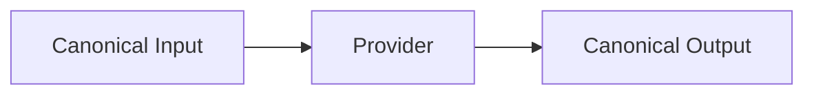

This prevents model evolution from forcing changes across the product.

---

## 24. AI Architecture Summary

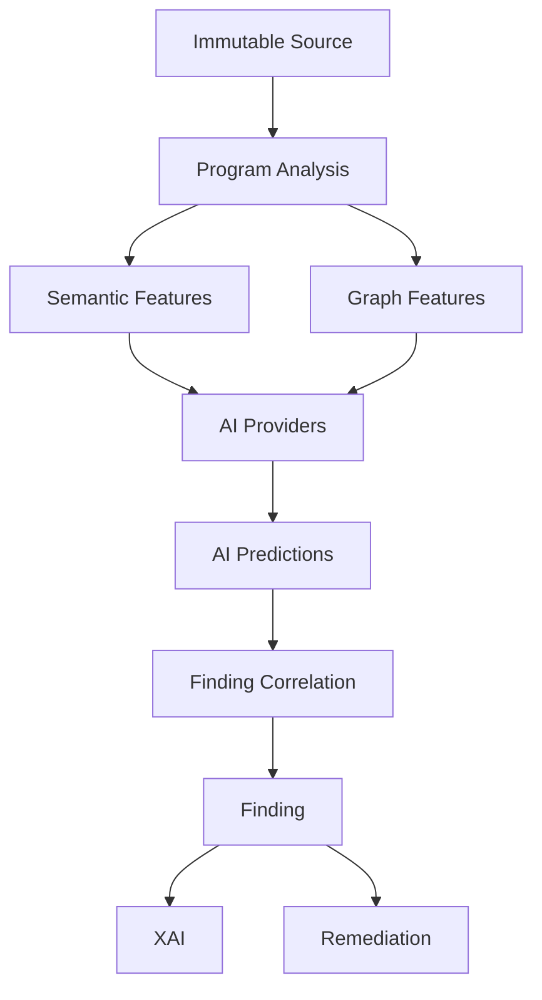

The AI layer is intentionally powerful but bounded by deterministic application logic and security controls.