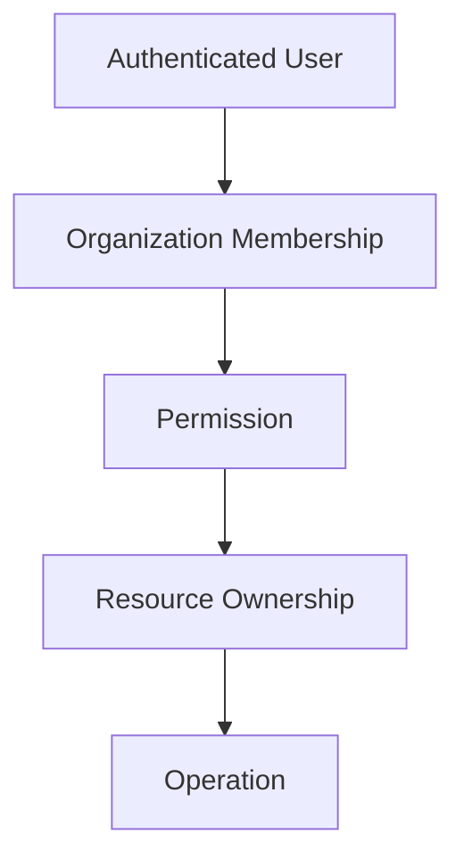
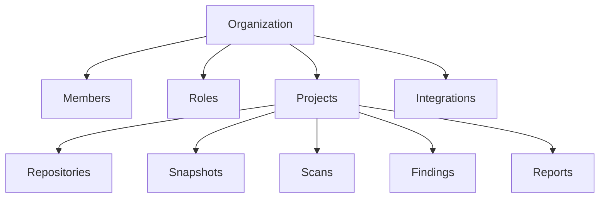
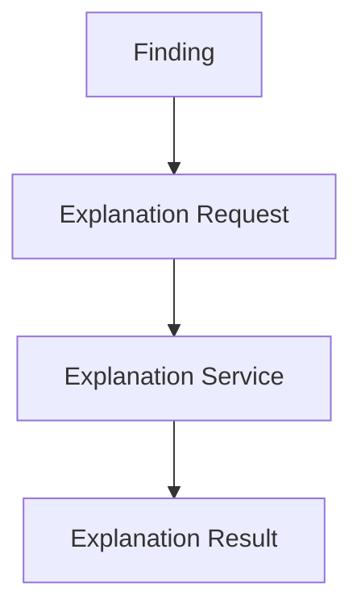
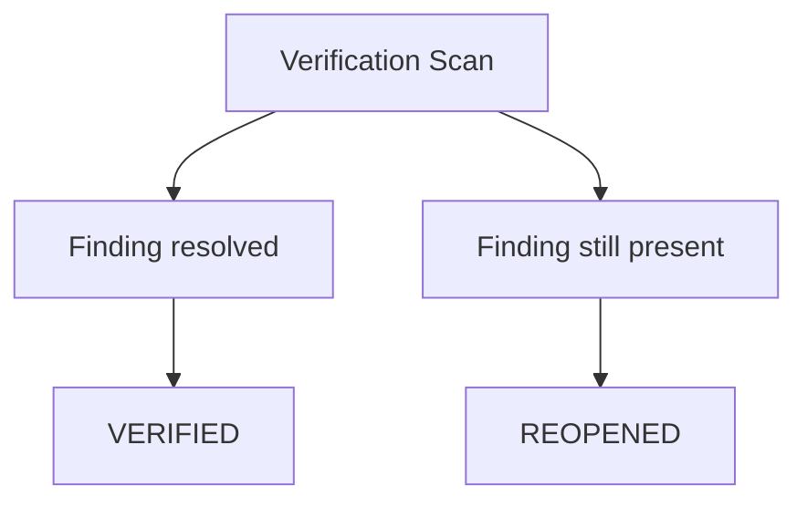
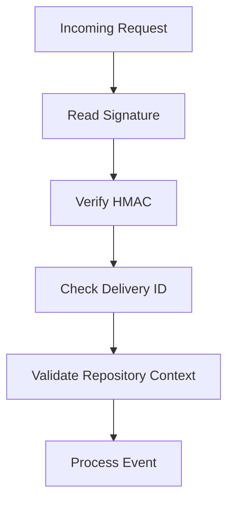
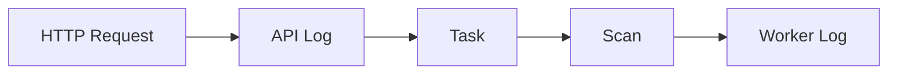

# VulnScan API

## 1. Purpose

The VulnScan API is the primary application boundary between the frontend, external integrations, and backend security services.

The API is responsible for:

- Authentication
- Authorization
- Tenant isolation
- Project management
- Repository management
- Source management
- Scan management
- Finding management
- XAI
- Remediation
- Validation
- Verification
- Reports
- Analytics
- Notifications
- Integrations
- Health and diagnostics

---

## 2. API Base

The API is exposed through the FastAPI application. API routes are versioned under:

```text
/api/v1
```

The exact runtime host and port are environment-dependent.

---

## 3. Authentication

Authenticated API requests use the application's session and token authentication mechanism.

Authentication operations include:

- Registration
- Login
- Logout
- Refresh
- Email verification
- Password recovery
- Password reset

Session lifecycle is tracked server-side.

---

## 4. Authorization

Authentication does not imply authorization. Each protected operation evaluates:



The frontend is not a security boundary.

---

## 5. Organization Context

Organization-scoped requests carry the active organization context. The backend validates that the authenticated user belongs to the requested organization.

Resources are always resolved within the authorized tenant context.

---

## 6. Core Resource Hierarchy



---

## 7. Authentication API

Representative operations:

```text
POST   /auth/register
POST   /auth/login
POST   /auth/refresh
POST   /auth/logout
POST   /auth/verify
POST   /auth/forgot-password
POST   /auth/reset-password
```

Exact schemas are defined by the FastAPI application.

---

## 8. Organization API

Organization operations include:

```text
GET    /organizations
POST   /organizations
GET    /organizations/{organization_id}
PATCH  /organizations/{organization_id}
```

Additional organization and member operations are protected by the corresponding permissions.

---

## 9. Project API

Project operations include:

```text
GET    /projects
POST   /projects
GET    /projects/{project_id}
PATCH  /projects/{project_id}
DELETE /projects/{project_id}
```

Project access is always organization-scoped.

---

## 10. Repository API

Repository operations cover workflows for:

- Creating repository connections
- Disconnecting repositories
- Synchronizing repositories
- Selecting branches
- Tracking commits
- Repository metadata
- Supported source acquisition

Repository operations require appropriate project permissions.

---

## 11. Source API

Source workflows include:

- Upload
- Snapshot creation
- Snapshot inspection
- Source file access
- Function metadata
- Source integrity metadata

A scan references an immutable snapshot.

---

## 12. Scan API

Scan operations include:

- Create scan
- Get scan
- List scans
- Get scan status
- Get stage status
- Cancel scan
- Retry scan
- List artifacts
- Download artifact

The scan API exposes explicit lifecycle information.

---

## 13. Scan Status

A scan response can expose:

- Scan identifier
- Project
- Source snapshot
- Purpose
- Status
- Current stage
- Stage progress
- Start time
- Completion time
- Failure information

Stage state distinguishes between:

- `PENDING`
- `RUNNING`
- `COMPLETED`
- `FAILED`
- `CANCELLED`
- `TIMED_OUT`
- `UNSUPPORTED`
- `NOT_RUN`

---

## 14. Finding API

Finding operations include:

- List findings
- Get finding
- Update finding state
- Assign finding
- Comment on finding
- Suppress finding
- Accept risk
- View finding history
- View occurrences

Finding mutations require the corresponding backend permission.

---

## 15. Finding Evidence

A finding can expose:

- Source location
- Severity
- CWE
- CVSS
- Confidence
- Risk
- Static evidence
- Taint evidence
- Graph evidence
- AI evidence
- Occurrences
- Lifecycle history

---

## 16. XAI API

The XAI API provides explanation information associated with a finding.



Explanation responses preserve model and provenance information.

---

## 17. Remediation API

Remediation operations include:

- Generate remediation
- Get remediation
- Approve remediation
- Reject remediation
- Apply remediation
- View validation

The exact routes and payload schemas are defined by the backend router.

---

## 18. Validation API

Validation operations expose:

- Validation creation
- Validation status
- Individual validation steps
- Validation failures
- Validation artifacts
- Final validation result

Validation is executed asynchronously.

---

## 19. Verification API

Verification is represented through the scan and finding lifecycle APIs. A verification scan is associated with the remediation and finding it is intended to verify.



---

## 20. Reports API

Report operations include:

- Create report
- Get report
- Get report status
- List reports
- Download report

Reports are generated asynchronously when generation is expensive.

Supported output formats:

- PDF
- HTML
- JSON
- CSV

---

## 21. Analytics API

Analytics endpoints provide organization and project security information derived from persisted security data. Analytics can include:

- Active projects
- Scan counts
- Finding counts
- Severity summaries
- Critical findings
- CWE information
- Security posture
- Historical security information, where supported

---

## 22. Notifications API

Notification operations include:

- List notifications
- Read notification
- Mark notification as read

Notifications are scoped to the organization and user.

---

## 23. Integration API

Integration APIs cover supported developer workflows, including:

- GitHub integration
- Security gates
- CI/CD
- Webhooks
- Repository and project mapping

Webhook endpoints authenticate incoming requests before processing them.

---

## 24. Webhook Security

Webhook processing follows this sequence:



Invalid or conflicting webhook deliveries must not be accepted as trusted events.

---

## 25. Health API

Health and diagnostics endpoints provide operational information for application dependencies. Typical dependency checks:

- PostgreSQL
- Redis
- Object storage
- Celery workers

Health responses distinguish application availability from individual dependency health where appropriate.

---

## 26. Error Contract

API errors should be structured and machine-readable. A security-sensitive error should communicate:

- Error code
- Human-readable message
- Request ID
- Relevant resource or context, when safe

Internal exception details must not be leaked to clients.

---

## 27. Request Correlation

Requests receive correlation identifiers. The request ID connects:



This allows long-running operations to be investigated across application boundaries.

---

## 28. API Security Rules

The API must:

1. Authenticate protected requests.
2. Validate organization membership.
3. Enforce permissions.
4. Verify resource ownership.
5. Validate all input.
6. Reject unsafe paths.
7. Bound large inputs.
8. Avoid exposing secrets.
9. Avoid leaking internal errors.
10. Record security-sensitive operations.

---

## 29. API Stability

Domain services should remain independent of frontend-specific implementation details.

API contracts should be changed deliberately and accompanied by:

- Schema changes
- Migrations, where required
- Backend tests
- Frontend updates
- Documentation updates

---

## 30. API Principle

The API is the authoritative boundary.

The frontend presents security state. The API enforces security state.