# VulnScan Architecture

## 1. Purpose

VulnScan is a multi-tenant security analysis platform. It takes source code from ingestion through static analysis, graph and taint analysis, AI-assisted vulnerability detection, explainability, remediation, validation, verification, reporting, and CI security workflows.

The architecture separates:

- Product and API concerns
- Tenant and authorization boundaries
- Source and evidence management
- Long-running analysis
- AI inference
- Finding correlation
- Explainability
- Remediation
- Patch validation
- Verification
- Reporting and analytics
- Developer integrations

The central architectural rule:

> AI assists security analysis, but authoritative security state is established by deterministic application logic, persisted evidence, validation, and verification.

---

## 2. System Architecture

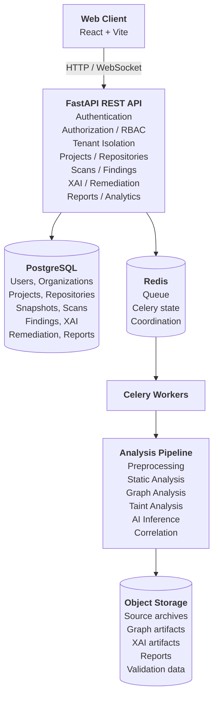

---

## 3. Architectural Boundaries

VulnScan is divided into logical boundaries, not independent deployable microservices.

### Frontend

The frontend is responsible for:

- Authentication flows
- Organization context
- Project management
- Repository management
- Scan configuration
- Scan progress
- Findings
- Source investigation
- XAI presentation
- Remediation workflow
- Validation results
- Verification status
- Reports
- Analytics
- Notifications
- Integrations
- Team collaboration

The frontend does not determine authoritative security state.

### API Layer

FastAPI is the application's primary API boundary. Its responsibilities include:

- Authentication
- Session handling
- Authorization
- Tenant enforcement
- Request validation
- Resource access
- Scan creation and control
- Finding operations
- XAI and remediation operations
- Reports
- Analytics
- Notifications
- Integrations
- Health endpoints

Long-running analysis is delegated to background workers.

### PostgreSQL

PostgreSQL is the authoritative store for application metadata and security state. It contains entities including:

- Users
- Organizations
- Organization members
- Roles
- Permissions
- Sessions
- Projects
- Repositories
- Branches
- Commits
- Source snapshots
- Source files
- Functions
- Scans
- Scan stages
- Findings
- Finding occurrences
- Finding history
- Assignments
- Comments
- Suppressions
- AI predictions
- Explanations
- Remediations
- Validation records
- Reports
- Notifications
- Security policies
- PR security results
- Webhook deliveries

Large artifacts are not required to live inside PostgreSQL.

### Redis

Redis is used for:

- Celery task queueing
- Worker coordination
- Runtime task state
- Short-lived coordination data
- Rate-limiting support, where configured

Redis is not the authoritative store for security findings.

### Object Storage

S3-compatible object storage holds large or immutable artifacts, such as:

- Source archives
- Source snapshots
- Graph artifacts
- Static-analysis artifacts
- XAI artifacts
- Remediation patches
- Validation artifacts
- Generated reports

Objects are addressed through controlled storage keys and protected by organization and resource authorization.

### Celery Workers

Celery workers run long-running operations outside the API process, such as:

- Source preprocessing
- Static analysis
- Graph construction
- Taint analysis
- AI inference
- Finding correlation
- Report generation
- Patch validation
- Verification scans
- Repository operations

Workers must not bypass domain authorization or tenant boundaries.

---

## 4. Source-of-Truth Model

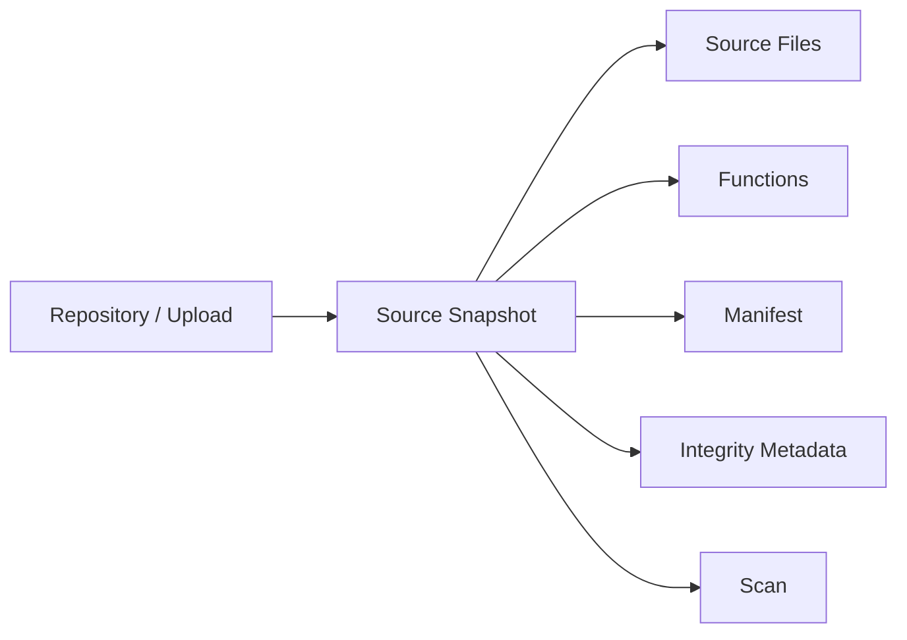

A scan references a specific immutable source snapshot. This prevents later repository changes from silently changing the source analyzed by a historical scan.

---

## 5. Analysis Pipeline

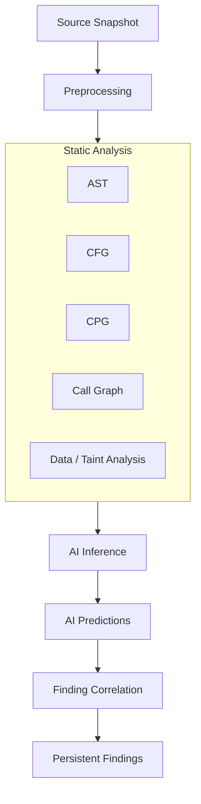

Each stage produces explicit state. A stage can be:

- Pending
- Running
- Completed
- Failed
- Timed out
- Cancelled
- Unsupported
- Not run

Unsupported or unavailable analysis must never be represented as successful analysis.

---

## 6. Graph Artifact Boundary

Graph analysis uses a canonical artifact boundary.

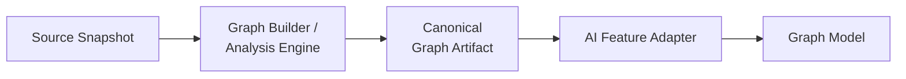

Graph artifacts carry metadata such as:

- `graph_artifact_id`
- `source_snapshot_id`
- `graph_type`
- `schema_version`
- `artifact_uri`
- `checksum`
- `node_count`
- `edge_count`
- `created_at`

Supported graph categories include:

- AST
- CFG
- CDG
- PDG
- CPG
- Call Graph
- Data Flow
- Pointer Analysis
- Taint
- Complexity
- API Usage

Actual availability depends on the configured analysis engine.

---

## 7. AI Boundary

AI inference is isolated behind provider interfaces. The rest of the application consumes canonical AI outputs and does not depend on a particular model implementation.

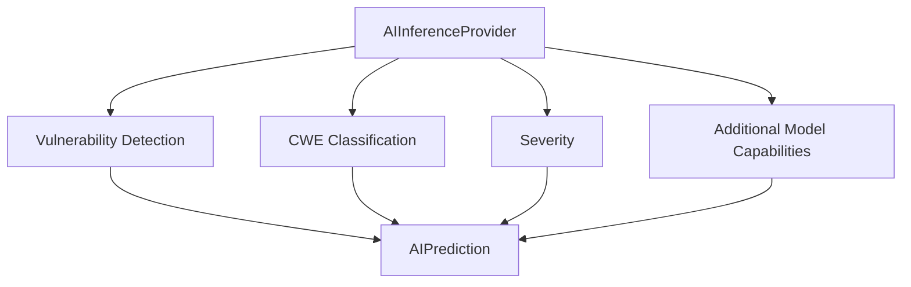

The canonical prediction records:

- Project
- Organization
- Scan
- Source snapshot
- Source / function location
- Prediction
- Confidence
- CWE
- Severity
- CVSS information
- Provider
- Model
- Model version
- Schema version
- Evidence / provenance

This boundary lets model implementations evolve independently of the finding domain.

---

## 8. Finding Domain

The finding engine correlates multiple signals into a single persistent finding.

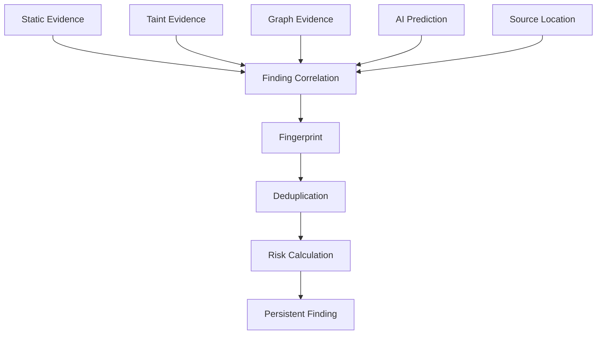

The finding fingerprint lets repeated scans recognize the same underlying issue. Occurrences represent appearances of a finding across scans without creating duplicate persistent findings.

---

## 9. XAI Boundary

Explainability is separated from vulnerability detection.

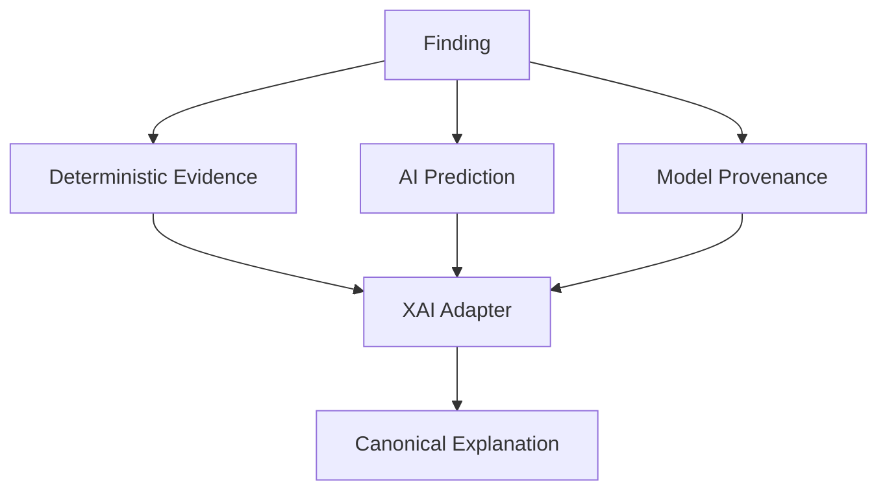

Explanation data may include:

- Important source locations
- Tokens
- Nodes
- Edges
- Attribution scores
- Explanation method
- Model information
- Evidence references
- Artifact references

Large explanation artifacts belong in object storage.

---

## 10. Remediation Boundary

Remediation is independent from the finding lifecycle.

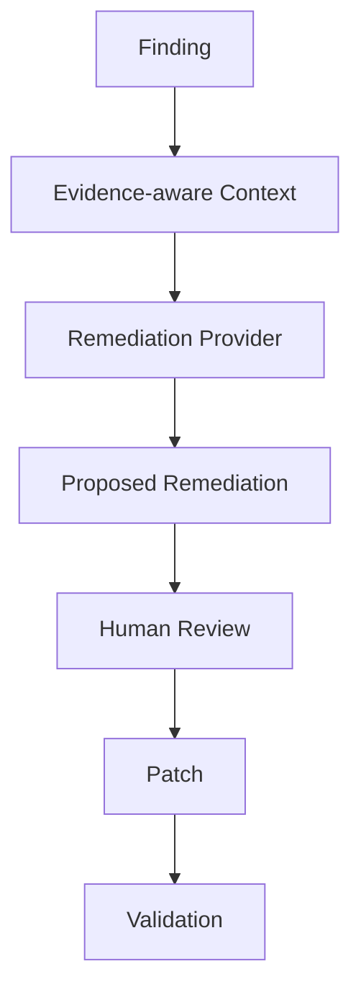

A remediation proposal is not automatically applied or considered verified.

---

## 11. Validation Boundary

Patch validation runs outside the primary API request path. The validation environment uses:

- Disposable workspaces
- Time limits
- Resource limits
- Sanitized environment variables
- Path validation
- Filesystem restrictions
- Controlled commands
- No application secrets

The exact level of process and kernel isolation depends on the deployment environment. Validation results are persisted and linked to the remediation.

---

## 12. Verification Boundary

Verification is authoritative application logic.

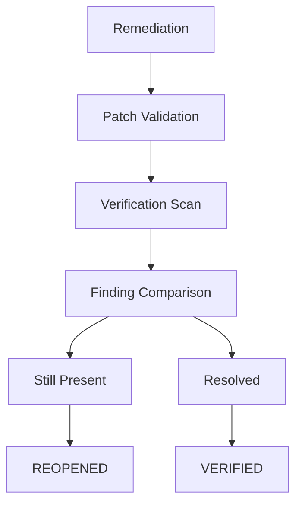

A successful validation run alone does not establish `VERIFIED`.

---

## 13. Tenant Isolation

Organization ownership is a first-class security boundary. Every organization-owned resource must be scoped through:

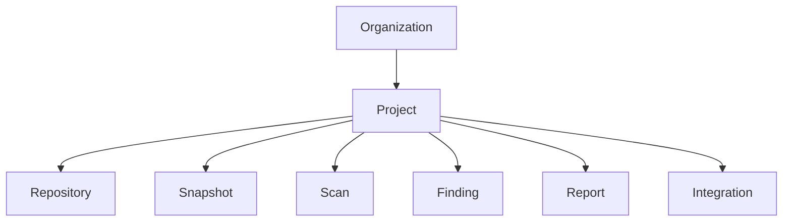

Resource identifiers are never treated as sufficient authorization. Authorization must verify:

1. Authentication
2. Organization membership
3. Permission
4. Resource ownership / context

---

## 14. RBAC

Authorization is centralized around permissions. Typical permissions cover:

- Organization management
- Member management
- Project management
- Repository management
- Scan management
- Finding management
- Remediation
- Reports
- Analytics
- Integrations
- Security policies
- Administration

The frontend may hide unavailable actions, but the backend remains authoritative.

---

## 15. Scan State Machine

A scan has explicit lifecycle state.

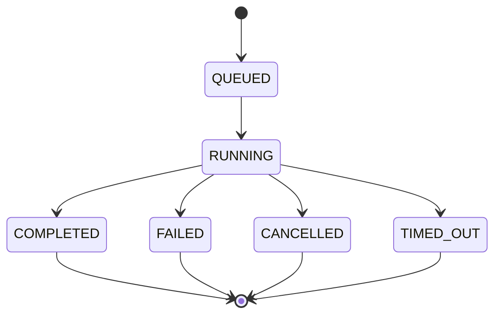

Individual analysis stages maintain their own state and execution metadata. Workers use heartbeats and failure handling to prevent scans from remaining indefinitely in a running state.

---

## 16. Reliability Model

Long-running work is designed to tolerate:

- Worker interruption
- Dependency failures
- Analysis-engine failures
- AI provider failures
- Storage failures
- Queue interruptions
- Scan cancellation
- Scan timeout
- Duplicate task execution

Idempotency is preferred for operations that may be retried.

---

## 17. Security Model

Security-sensitive operations follow this sequence:

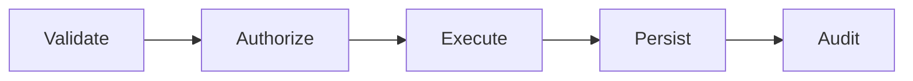

Important security boundaries include:

- Tenant isolation
- RBAC
- Session security
- API key handling
- Archive extraction
- Untrusted source processing
- Command execution
- AI output
- Model artifacts
- Webhook authentication
- Validation execution

---

## 18. Reporting and Analytics

Reporting consumes persisted application data.

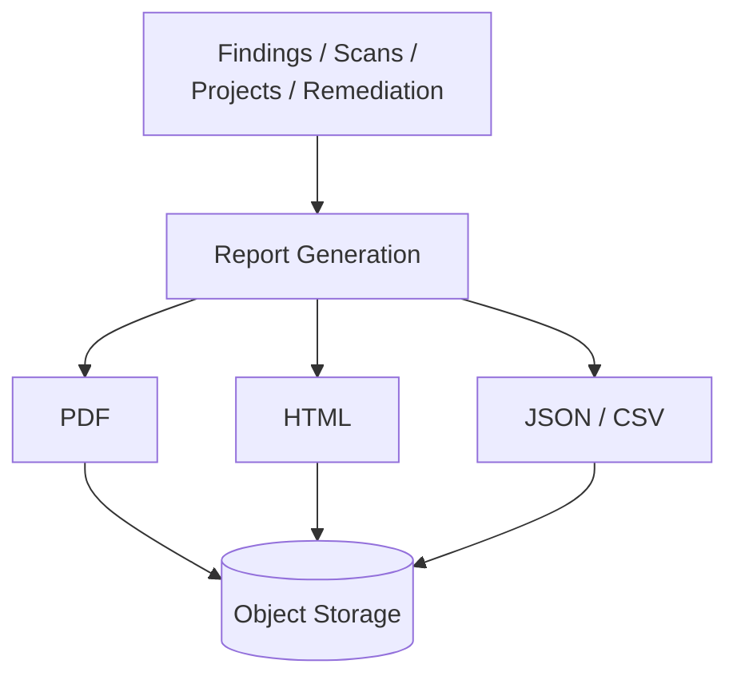

Analytics operate on the same authoritative domain data. The application must not create synthetic security metrics solely for presentation.

---

## 19. CI/CD Architecture

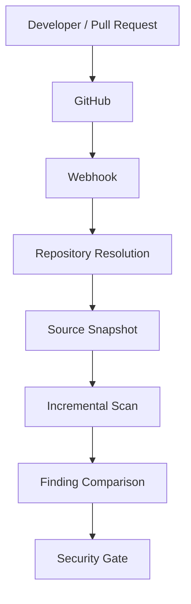

Security gates evaluate configured policies against the resulting security state.

---

## 20. Design Rules

VulnScan follows these architectural rules:

1. Source snapshots are immutable.
2. Security state is persisted.
3. Tenant boundaries are enforced server-side.
4. Authorization is centralized.
5. Long-running work does not execute inside request handlers.
6. AI output is untrusted.
7. Unsupported analysis is represented explicitly.
8. Verification is separate from remediation.
9. Large artifacts use object storage.
10. Security evidence remains traceable to its source.
11. Retries must not create duplicate security state.
12. Frontend presentation never replaces backend authorization.
13. Historical migrations remain authoritative.
14. New capabilities should extend existing domain boundaries rather than bypass them.