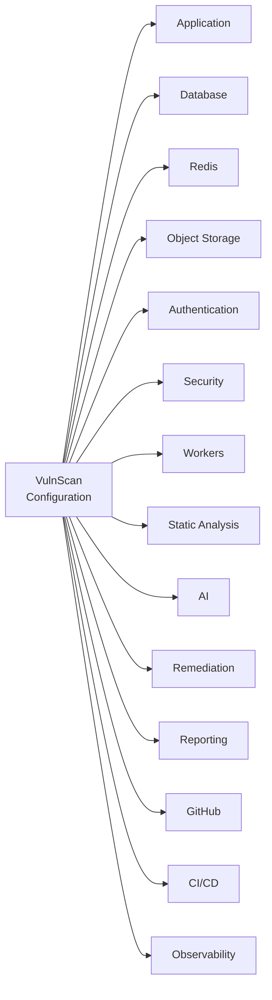

# VulnScan Configuration

## 1. Purpose

VulnScan uses environment-driven configuration.

Secrets must be provided through environment variables or an appropriate secret-management system, and must never be committed to source control.

---

## 2. Configuration Layers

Configuration is divided conceptually into the following layers:



---

## 3. Environment Files

Development commonly uses:

```text
.env.example
backend/.env.example
frontend/.env.example
```

These files document expected configuration without containing production secrets.

---

## 4. Application Configuration

Typical application settings include:

```text
APP_NAME
APP_ENV
APP_DEBUG
APP_HOST
APP_PORT
```

Production deployments should disable development and debug behavior.

---

## 5. Database Configuration

PostgreSQL configuration includes the database connection information. Typical setting:

```text
DATABASE_URL
```

Database credentials must never be committed. Alembic uses the configured database connection for migrations.

---

## 6. Redis Configuration

Redis is used by the background-processing layer. Typical setting:

```text
REDIS_URL
```

Redis availability affects:

- Celery
- Queue processing
- Runtime coordination
- Rate limiting, where configured

---

## 7. Object Storage

VulnScan uses S3-compatible object storage. Typical settings include:

```text
S3_ENDPOINT_URL
S3_ACCESS_KEY
S3_SECRET_KEY
S3_BUCKET
S3_REGION
```

Exact variable names should follow the repository's current environment templates. Object-storage credentials are secrets.

---

## 8. Authentication Configuration

Authentication configuration may include:

- JWT / token settings
- Session lifetime
- Refresh lifetime
- Password reset lifetime
- Verification token lifetime

Security-sensitive values must be environment-specific.

---

## 9. API Keys

API keys must be treated as credentials. The application stores protected representations rather than exposing raw secret material after creation.

Never commit API keys into:

- `.env` files
- Source files
- Tests
- Documentation
- Screenshots
- Git history

---

## 10. Rate Limiting

Rate limits are applied to security-sensitive operations. Examples include:

- Login
- Registration
- Token refresh
- Scan creation
- Report generation
- Webhook processing

Where distributed enforcement is required, Redis-backed enforcement should be used. Development-only in-memory behavior must not be assumed to provide multi-worker distributed guarantees.

---

## 11. Source Upload Configuration

Source ingestion must be bounded. Relevant controls include:

- Maximum archive size
- Maximum extracted size
- Maximum file count
- Maximum individual file size
- Extraction timeout
- Workspace limits

These limits protect the application against archive bombs and resource exhaustion.

---

## 12. Worker Configuration

Celery workers require configuration for:

- Broker
- Result and runtime state, where used
- Concurrency
- Task timeouts
- Worker limits
- Retry behavior

Long-running security-analysis tasks should remain outside the API process.

---

## 13. Static Analysis Configuration

Static-analysis configuration may include:

- Analysis engine availability
- Executable paths
- Timeouts
- Workspace configuration
- Artifact output location

External analysis engines must be treated as optional dependencies unless the deployment explicitly requires them.

---

## 14. AI Configuration

AI configuration includes:

- Provider selection
- Model registry configuration
- Model artifact location
- Model checksum
- Runtime and device configuration
- Inference timeout
- Batch size
- Resource limits

AI failures must be represented explicitly. The system must not silently convert unavailable inference into fabricated security results.

---

## 15. Explainability Configuration

XAI configuration can include:

- Explanation method
- Model runtime
- Artifact storage
- Attribution limits
- Execution timeout

Supported methods may include:

- Integrated Gradients
- SHAP
- GNNExplainer
- Attention attribution

Availability depends on the configured model and runtime.

---

## 16. Remediation Configuration

Remediation providers may require provider-specific configuration. Secrets such as provider API keys must be supplied through environment configuration.

The remediation layer should also define:

- Generation timeout
- Output limits
- Context limits
- Validation requirements

---

## 17. Validation Configuration

Patch validation should be bounded by:

- Workspace location
- Execution timeout
- CPU limits, where supported
- Memory limits, where supported
- Disk limits, where supported
- Allowed commands
- Network policy
- Environment sanitization

Validation workspaces must not inherit application secrets.

---

## 18. GitHub Configuration

GitHub integrations may require:

- Application credentials
- Webhook secret
- Repository mapping
- Organization and project mapping
- Security-gate policy

Webhook secrets are security-sensitive credentials.

---

## 19. Reporting Configuration

Report generation may require:

- Object-storage configuration
- Output limits
- Worker configuration
- Temporary workspace configuration

Generated reports should be stored under controlled organization and project ownership.

---

## 20. Observability Configuration

Observability configuration may include:

- Log level
- Request ID behavior
- Metrics configuration
- Health checks
- Worker diagnostics

Logs must not expose:

- Passwords
- API keys
- Access tokens
- Refresh tokens
- Webhook secrets
- Database credentials
- Provider credentials

---

## 21. Frontend Configuration

Frontend configuration should contain only values intended for browser exposure. Never place private credentials in frontend environment variables.

The browser must communicate with the backend through the configured API boundary.

---

## 22. Development Configuration

Development may use:

- Local PostgreSQL
- Local Redis
- Local object storage
- Docker Compose
- Development credentials
- Local analysis runtimes

Development configuration must remain separate from production secrets.

---

## 23. Production Configuration Principles

Production configuration should:

1. Disable debug mode.
2. Use strong secrets.
3. Use secure database credentials.
4. Use protected object-storage credentials.
5. Use distributed rate limiting where required.
6. Restrict worker resources.
7. Restrict validation execution.
8. Protect webhook secrets.
9. Validate model integrity.
10. Enable appropriate logging and monitoring.

---

## 24. Secret Management

Never store secrets in:

- Git
- README files
- Source code
- Frontend bundles
- Screenshots
- Test fixtures
- Generated reports
- Docker images

Use the deployment environment's secret-management facilities.

---

## 25. Configuration Precedence

When multiple configuration sources exist, the application's configuration loader defines the authoritative precedence. Avoid maintaining separate undocumented configuration paths.

The environment templates should remain synchronized with the actual application configuration.

---

## 26. Configuration Validation

Configuration should fail early when a required security-sensitive value is missing. Examples:

- Required secret missing
- Invalid database URL
- Invalid object-storage configuration
- Invalid model checksum
- Invalid webhook configuration

A missing optional capability should be represented as unavailable, not silently replaced with an incorrect implementation.

---

## 27. Configuration Checklist

Before running VulnScan:

- [ ] Database configured
- [ ] Redis configured
- [ ] Object storage configured
- [ ] Authentication secrets configured
- [ ] Worker configuration verified
- [ ] Upload limits configured
- [ ] Analysis configuration verified
- [ ] AI configuration verified
- [ ] Validation limits configured
- [ ] GitHub secrets configured, where applicable
- [ ] Logging configured
- [ ] No production secret committed to source