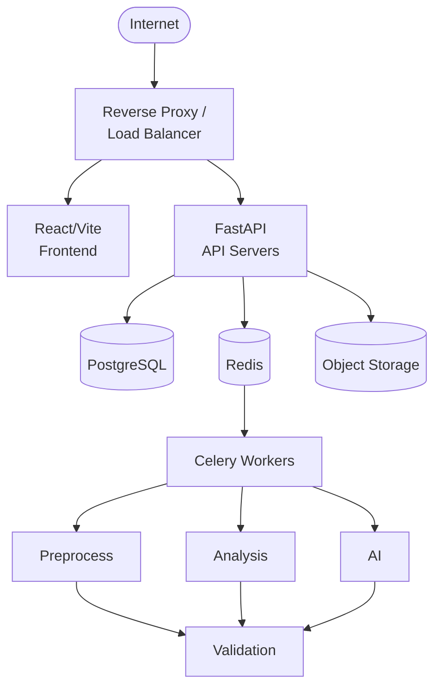
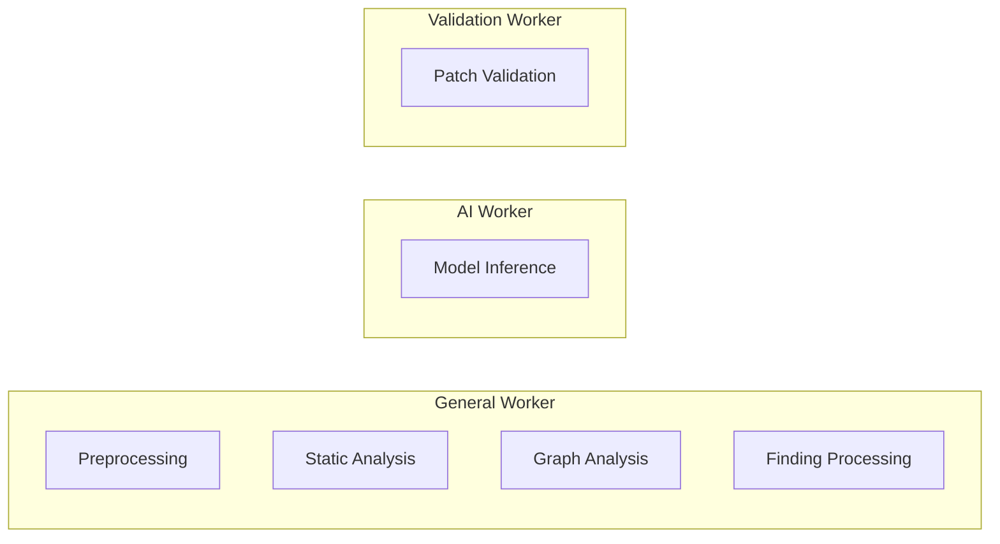
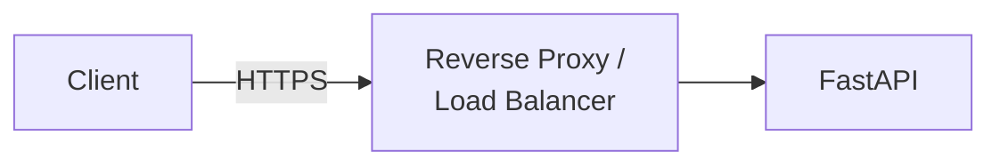
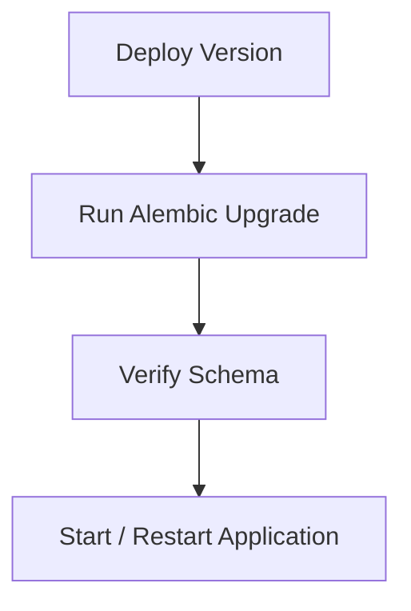
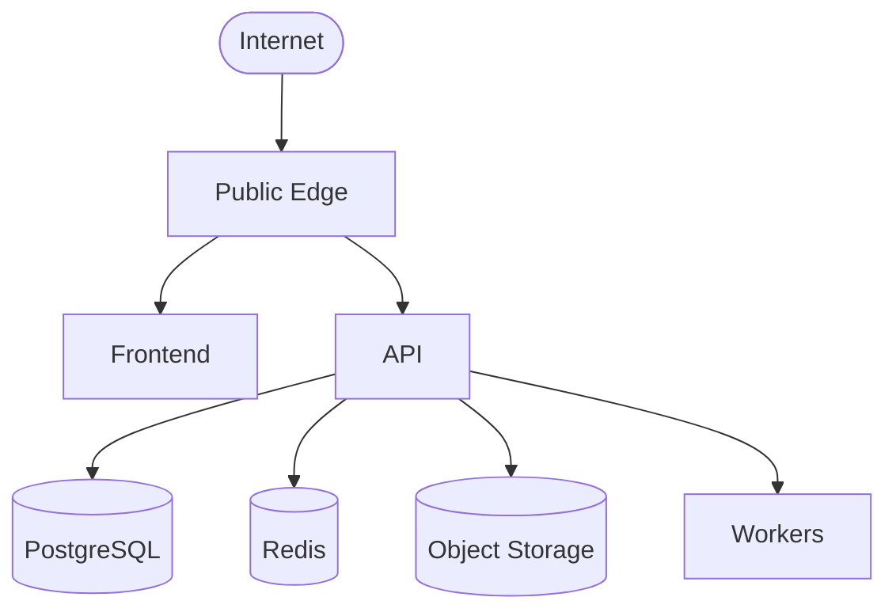
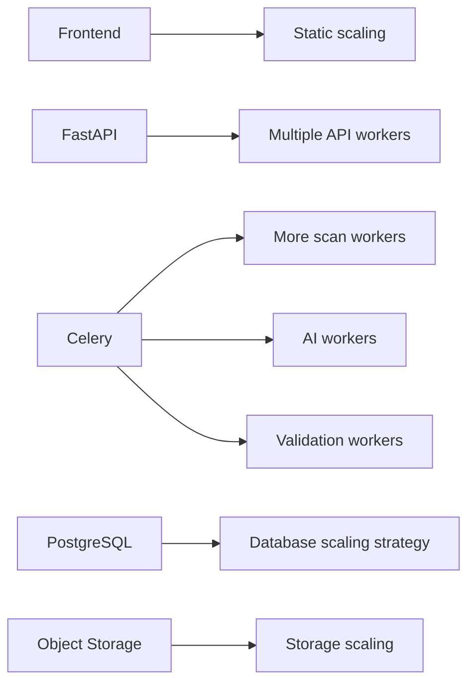
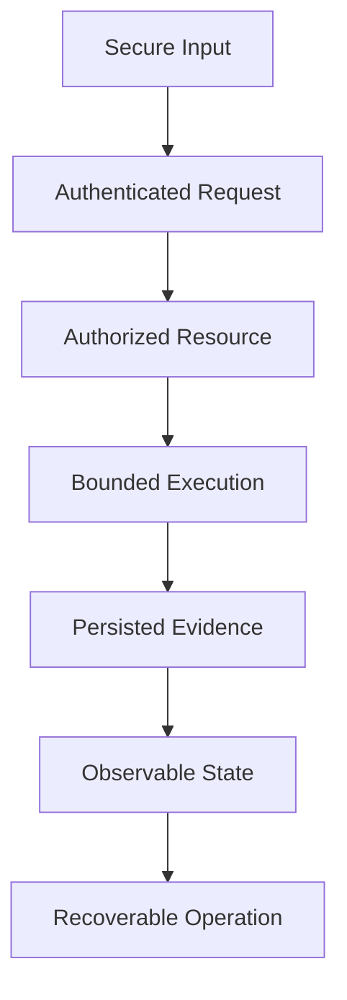

# VulnScan Deployment Guide

## 1. Purpose

This document describes the deployment architecture and operational requirements for VulnScan.

VulnScan is designed around:

- React/Vite
- FastAPI
- PostgreSQL
- Redis
- Celery
- S3-compatible object storage
- Analysis workers
- AI provider infrastructure

The deployment should preserve the same logical security boundaries used during development.

---

## 2. Deployment Architecture

---

## 3. Deployment Components

### Frontend

The frontend serves the VulnScan web application. It should be served through a production-capable web server or static hosting layer.

### FastAPI

FastAPI provides the primary API. Production API servers should:

- Run without debug mode
- Use secure configuration
- Use appropriate worker and process settings
- Sit behind TLS termination
- Have health monitoring
- Have access to required dependencies

### PostgreSQL

PostgreSQL is the authoritative application database. It stores:

- Identity
- Organizations
- Projects
- Repositories
- Source metadata
- Scans
- Findings
- XAI
- Remediation
- Reports
- Notifications
- Security policies
- Integration state

Production PostgreSQL should have:

- Backups
- Access controls
- Encryption, where required
- Connection limits
- Monitoring
- Recovery procedures

### Redis

Redis supports:

- Celery
- Runtime task coordination
- Queueing
- Rate limiting, where configured

Redis should not be treated as the permanent security-data store.

### Object Storage

Object storage holds large artifacts, such as:

- Source archives
- Graph artifacts
- XAI artifacts
- Reports
- Validation artifacts
- Other generated security artifacts

Production object storage should use:

- Private buckets
- Strong credentials
- Encryption, where required
- Lifecycle policies
- Access logging, where appropriate

---

## 4. Celery Workers

Workers execute long-running workloads. Recommended logical worker categories:

The exact deployment topology can remain simple until workload requirements justify further separation.

---

## 5. TLS

Production traffic should use HTTPS.

Internal service encryption should follow the deployment environment's security requirements.

---

## 6. Secrets

Production secrets must be injected through a secure secret-management mechanism.

Never store production secrets in:

- Git
- Dockerfiles
- Frontend source
- Public configuration
- README files
- Images
- Logs

Relevant secrets may include:

- Database credentials
- Redis credentials
- Object-storage credentials
- Authentication secrets
- GitHub secrets
- AI provider credentials
- Webhook secrets

---

## 7. Database Migration

Migrations must be applied before or as part of application deployment.

Never rely on runtime model creation as a replacement for Alembic.

---

## 8. Deployment Order

A controlled deployment can follow this order:

1. Prepare infrastructure
2. Verify configuration
3. Back up the database
4. Apply migration
5. Deploy backend
6. Deploy workers
7. Deploy frontend
8. Verify health
9. Verify queue processing
10. Verify object storage
11. Verify critical user workflows

---

## 9. Health Checks

Production monitoring should verify:

- API availability
- Database connectivity
- Redis connectivity
- Object storage availability
- Worker health
- Queue processing

Health endpoints should distinguish dependency failure from total application failure where possible.

---

## 10. Worker Health

Worker monitoring should track:

- Worker availability
- Queue depth
- Task execution
- Task failures
- Task duration
- Stale tasks
- Resource consumption

A worker that remains alive but stops processing tasks should be detectable.

---

## 11. Scan Reliability

Long-running scans should expose:

- Scan state
- Stage state
- Heartbeats
- Start time
- Completion time
- Failure information
- Cancellation
- Timeout

The platform should recover stale work according to its configured recovery policy.

---

## 12. Resource Limits

Production workloads should be bounded. Relevant limits include:

- API request size
- Upload size
- Archive size
- Extracted file count
- Worker memory
- Worker CPU
- Scan timeout
- Validation timeout
- Model inference timeout
- Report-generation timeout

---

## 13. Validation Execution

Validation is a high-risk execution boundary. Where threat requirements demand it, production deployment should provide stronger isolation than a simple shared temporary directory.

Possible infrastructure controls include:

- Dedicated worker nodes
- Containers
- Namespaces
- cgroups
- Seccomp
- Restricted filesystem
- Network isolation
- Ephemeral execution environments

The security properties of the deployment must match the claims made to users.

---

## 14. Network Security

Recommended network layout:

Databases, Redis, and internal workers should not be unnecessarily exposed to the public internet.

---

## 15. Database Backups

Production PostgreSQL should have:

- Automated backups
- Retention policy
- Recovery testing
- Point-in-time recovery, where required
- Backup monitoring

A backup that has never been restored should not be considered a verified recovery strategy.

---

## 16. Object Storage Backups

Important security artifacts should have an appropriate durability strategy. Relevant artifacts include:

- Source snapshots
- Graph artifacts
- Reports
- XAI artifacts
- Validation records and artifacts

Object-storage lifecycle and retention policies should match product requirements.

---

## 17. Logging

Production logs should include:

- Timestamp
- Severity
- Request ID
- Organization ID, where safe
- Project ID, where safe
- Scan ID
- Task ID
- Worker ID
- Event information

Sensitive values must be redacted.

---

## 18. Metrics

Important operational measurements include:

- API request count
- API error count
- API latency
- Queue delay
- Scan duration
- Stage duration
- Static-analysis duration
- Graph-analysis duration
- Taint-analysis duration
- AI inference duration
- Validation duration
- Report-generation duration
- Task failure rate
- Worker health

---

## 19. Alerting

Operational alerts should cover:

- API outage
- Database outage
- Redis outage
- Object-storage outage
- Worker failure
- Queue backlog
- High task failure rate
- Excessive scan duration
- Validation failures
- Storage capacity
- Resource exhaustion

---

## 20. Rate Limiting

Production rate limiting should be compatible with the deployment topology. When multiple API workers are active, rate-limit state should be shared through a distributed mechanism.

A process-local limiter must not be presented as globally distributed enforcement.

---

## 21. GitHub Webhooks

Production webhook configuration should include:

- HTTPS endpoint
- Strong webhook secret
- Signature validation
- Replay protection
- Delivery tracking
- Repository mapping
- Error monitoring

Webhook secrets must not be exposed to the frontend.

---

## 22. AI Model Deployment

AI inference may require specialized resources. The deployment should define:

- Model artifact location
- Model checksum
- Runtime dependencies
- CPU/GPU requirements
- Memory requirements
- Inference timeout
- Batch limits
- Worker capacity

Model availability must be visible to the application.

---

## 23. Scaling

The system can scale individual components independently where required.

Scaling should follow measured workload requirements rather than speculative infrastructure.

---

## 24. Deployment Verification

After deployment, verify:

- [ ] Frontend loads
- [ ] Authentication works
- [ ] Organization context works
- [ ] Project creation works
- [ ] Repository ingestion works
- [ ] Snapshot creation works
- [ ] Scan creation works
- [ ] Worker consumes task
- [ ] Scan progresses
- [ ] Findings appear
- [ ] Source viewer works
- [ ] XAI workflow works
- [ ] Remediation workflow works
- [ ] Validation works
- [ ] Verification works
- [ ] Reports work
- [ ] Analytics work
- [ ] Notifications work
- [ ] GitHub integration works, where configured
- [ ] Health endpoints work

---

## 25. Rollback

Deployment rollback should account for:

- Application version
- Worker version
- Database schema
- Object-storage compatibility
- API contract compatibility

Database migrations should be designed so that a deployment rollback does not unintentionally destroy required data.

---

## 26. Incident Response

Security incidents should preserve:

- Request IDs
- Scan IDs
- Task IDs
- Worker IDs
- Audit logs
- Security events
- Relevant artifact checksums

Do not delete evidence required to understand an incident.

---

## 27. Production Principle

VulnScan should be deployed with the same architectural principles used by the application:

Production infrastructure should strengthen these boundaries rather than bypass them.