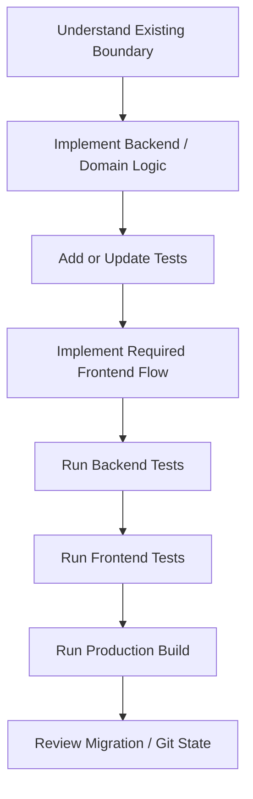
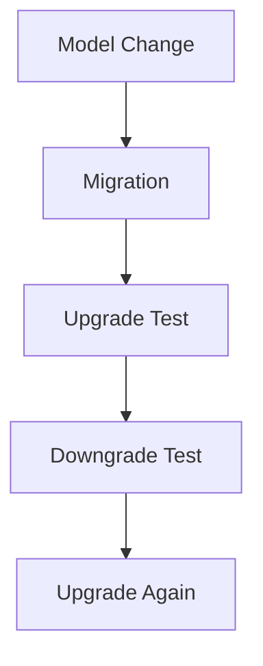

# VulnScan Development Guide

## 1. Purpose

This document describes the local development workflow for VulnScan.

The repository contains:

- React/Vite frontend
- FastAPI backend
- PostgreSQL
- Redis
- Celery workers
- S3-compatible object storage
- Analysis services
- AI provider boundaries
- Tests
- Documentation

---

## 2. Prerequisites

Install:

- Git
- Python
- Node.js
- npm
- Docker
- Docker Compose

Additional tools may be required for specific analysis and model capabilities.

---

## 3. Repository Layout

```text
VulnScan/
├── backend/
├── frontend/
├── cli/
├── docs/
├── scripts/
├── .github/
├── docker-compose.yml
├── pyproject.toml
└── README.md
```

---

## 4. Backend Structure

The backend is organized approximately as:

```text
backend/
├── app/
│   ├── core/
│   ├── models/
│   ├── repositories/
│   ├── routers/
│   ├── schemas/
│   ├── services/
│   └── main.py
├── alembic/
└── tests/
```

The application is divided by responsibility rather than by individual endpoint implementation.

---

## 5. Frontend Structure

The frontend is organized around:

```text
frontend/src/
├── components/
├── pages/
├── services/
├── stores/
└── ...
```

Frontend responsibilities include presentation, interaction, client state, API communication, and workflow navigation.

Security authorization remains backend-owned.

---

## 6. Local Environment

Start from the repository environment templates:

```text
.env.example
backend/.env.example
frontend/.env.example
```

Create local environment configuration without committing secrets.

---

## 7. Docker Compose

Start the development stack:

```bash
docker compose up --build
```

Check services:

```bash
docker compose ps
```

Stop services:

```bash
docker compose down
```

---

## 8. Database Migrations

Alembic is the authoritative database schema mechanism.

Apply migrations:

```bash
alembic upgrade head
```

Check the current migration:

```bash
alembic current
```

Inspect migration history:

```bash
alembic history
```

Do not introduce `Base.metadata.create_all()` as a replacement for migrations.

---

## 9. Backend Tests

Run the backend test suite:

```bash
python -m pytest backend/tests/
```

Tests cover application behavior across areas including:

- Authentication
- Authorization
- Tenant isolation
- Source ingestion
- Scan pipeline
- Findings
- AI boundaries
- XAI
- Remediation
- Validation
- Verification
- Reporting
- Integrations
- Security
- Reliability

---

## 10. Frontend Tests

Run frontend tests:

```bash
npm test -- --run
```

The frontend suite should verify:

- Components
- State behavior
- API interaction
- User workflows
- Permission-aware UI behavior

---

## 11. Frontend Build

Create a production build:

```bash
npm run build
```

A successful build is required before considering frontend changes complete.

---

## 12. Development Workflow

Recommended workflow:



---

## 13. Backend Development Rules

Backend changes should:

1. Preserve tenant isolation.
2. Use centralized authorization.
3. Validate input.
4. Keep long-running work out of request handlers.
5. Preserve existing state machines.
6. Use migrations for schema changes.
7. Preserve provenance.
8. Avoid silent fallback.
9. Record explicit failure states.

---

## 14. Frontend Development Rules

Frontend changes should:

1. Use existing shared components.
2. Follow the existing design language.
3. Use semantic icons.
4. Avoid fake loading states.
5. Avoid fake security results.
6. Represent loading, error, empty, and unsupported states explicitly.
7. Never rely on frontend-only authorization.
8. Use backend API contracts.
9. Keep security terminology consistent.

---

## 15. Adding a New Backend Feature

Use this order:

1. Identify the domain owner.
2. Identify the resource and organization scope.
3. Define schema changes if required.
4. Add a migration.
5. Add model and repository logic.
6. Add service logic.
7. Add authorization.
8. Add the API route.
9. Add tests.
10. Add the frontend workflow if user-facing.
11. Update documentation.

---

## 16. Adding a New Scan Stage

A new scan stage should define:

- Stage name
- Input
- Output
- State transitions
- Timeout
- Failure behavior
- Cancellation behavior
- Artifact behavior
- Tenant ownership
- Retry and idempotency behavior
- UI representation

A stage must not silently produce partial security state.

---

## 17. Adding a New AI Model

A new model should be integrated through the provider boundary. The integration should define:

- Model identifier
- Version
- Artifact
- Checksum
- Runtime
- Input schema
- Output schema
- Resource requirements
- Failure behavior
- Provenance

The rest of VulnScan should consume the canonical provider output.

---

## 18. Adding a New XAI Method

A new explanation method should implement the explanation boundary. It should define:

- Input requirements
- Model requirements
- Output schema
- Attribution representation
- Failure states
- Artifact storage
- Provenance

---

## 19. Adding a New Remediation Provider

A remediation provider should:

1. Receive controlled finding context.
2. Produce structured remediation output.
3. Preserve provider and model provenance.
4. Never directly modify authoritative security state.
5. Pass generated patches into the review and validation workflow.

---

## 20. Database Changes

Every schema change requires an Alembic migration.



Migrations should be deterministic and reversible where practical.

---

## 21. Testing Security Changes

Security-sensitive changes should test:

- Unauthorized access
- Cross-organization access
- Invalid ownership
- Missing permission
- Invalid session
- Invalid API key
- Unsafe input
- Replay
- Resource exhaustion
- Provider failure

Do not rely only on successful-path tests.

---

## 22. Logging During Development

Logs should contain useful correlation identifiers.

Avoid logging:

- Passwords
- Tokens
- API keys
- Secrets
- Raw webhook secrets
- Provider credentials

---

## 23. Code Quality

Before committing:

```bash
python -m pytest backend/tests/
npm test -- --run
npm run build
git status
```

Also review:

- Migration state
- Generated files
- Temporary artifacts
- Secrets
- Debug statements
- Unused imports
- Stale documentation

---

## 24. Git Hygiene

Do not commit:

```text
.env
*.patch
*.diff
temporary validation workspaces
generated model artifacts
private credentials
runtime logs
temporary archives
```

The repository should remain clean and reproducible.

---

## 25. Documentation Rule

A feature is not complete when only its implementation exists.

User-visible or architectural changes should update the relevant documentation. Documentation should describe the actual system rather than planned future behavior.

---

## 26. Pull Request Checklist

Before opening a PR:

- [ ] Backend behavior implemented
- [ ] Authorization verified
- [ ] Tenant isolation verified
- [ ] Tests added or updated
- [ ] Frontend updated where required
- [ ] Frontend build passes
- [ ] Migration tested
- [ ] No secrets committed
- [ ] No temporary artifacts committed
- [ ] Documentation updated
- [ ] Error states handled
- [ ] Unsupported and unavailable states handled
- [ ] Logs reviewed
- [ ] Git status clean except intended changes