# VulnScan Remediation, XAI & Verification

## 1. Purpose

This document describes the path from an identified vulnerability to an explained, reviewed, validated, and verified remediation.

The remediation architecture deliberately separates:

1. Detection
2. Explanation
3. Remediation proposal
4. Human review
5. Patch validation
6. Verification

A generated patch is never treated as a verified security fix merely because it was generated successfully.

---

## 2. Remediation Lifecycle

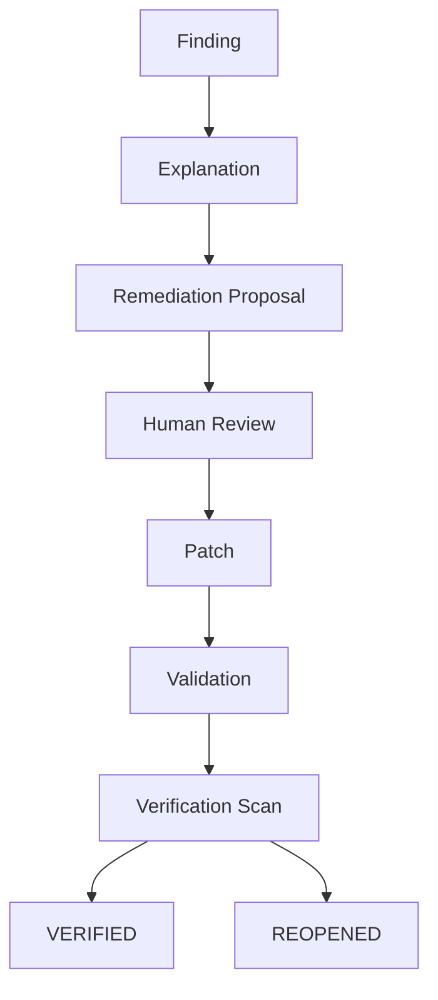

---

## 3. Explainability

XAI provides additional context around model predictions. The explanation layer can use:

- Integrated Gradients
- SHAP
- GNNExplainer
- Attention attribution
- Token attribution
- Node attribution
- Edge attribution

The exact explanation method depends on the available model and runtime.

---

## 4. Evidence-Aware Explanation

An explanation is generated from security context rather than from an isolated model output.

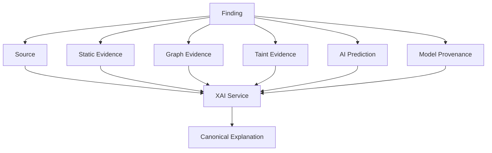

The explanation distinguishes AI interpretation from deterministic evidence.

---

## 5. Explanation Data

A canonical explanation can contain:

- Finding reference
- Model reference
- Explanation method
- Source locations
- Tokens
- Graph nodes
- Graph edges
- Attribution values
- Evidence references
- Artifact references
- Generation metadata

Large explanation artifacts can be stored in object storage.

---

## 6. XAI Trust Boundary

XAI explains a model prediction. It does not independently establish that a vulnerability exists.

The authoritative finding remains the product's persisted finding state and evidence.

---

## 7. Remediation Provider

Remediation generation is isolated behind a provider boundary.

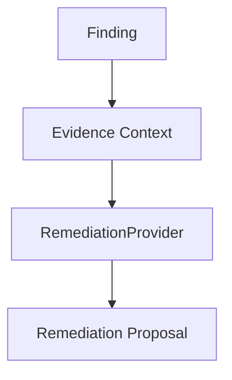

The provider receives controlled context. The application remains responsible for:

- Authorization
- Finding state
- Patch persistence
- Review
- Validation
- Verification

---

## 8. Remediation States

A remediation moves through controlled states.

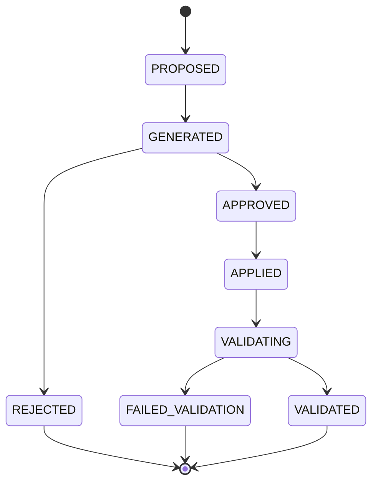

A newer remediation can supersede an older proposal where applicable.

---

## 9. Human Review

A remediation proposal is reviewable before application.

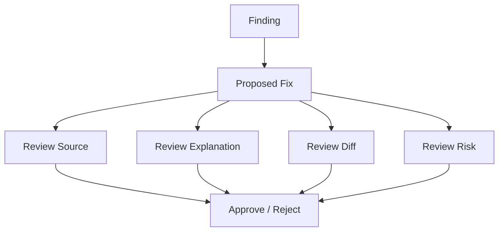

Approval does not skip validation.

---

## 10. Patch Representation

A remediation patch is associated with:

- Finding
- Project
- Source snapshot
- Remediation
- Provider and model provenance, where applicable
- Patch content
- Integrity information
- Lifecycle state

The original source snapshot remains immutable.

---

## 11. Validation Workspace

Patch validation occurs in a disposable workspace.

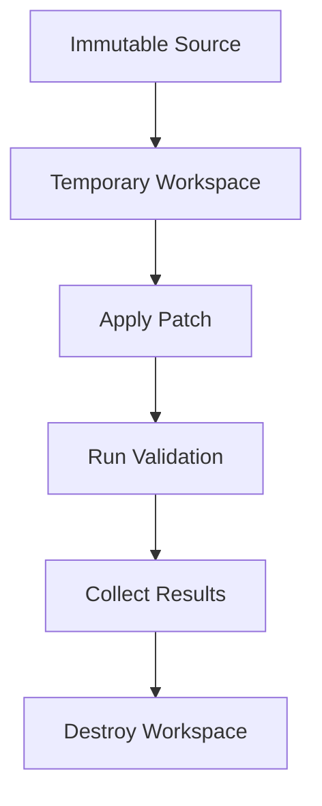

The API process must not execute arbitrary repository commands directly.

---

## 12. Validation Security

The validation environment should enforce:

- Time limits
- CPU limits, where supported
- Memory limits, where supported
- Disk limits, where supported
- Path restrictions
- Sanitized environment variables
- No application credentials
- No database credentials
- No object-storage credentials
- Controlled command execution
- Disposable filesystem state

The exact isolation level depends on deployment infrastructure.

Kernel-level sandboxing is a deployment concern and must not be assumed merely because a temporary directory is used.

---

## 13. Validation Stages

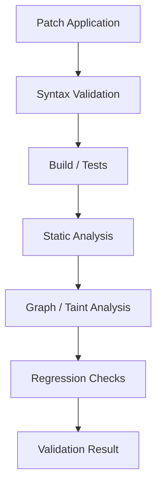

A failure in any required validation step prevents the remediation from being considered validated.

---

## 14. Validation Result

A validation record should preserve:

- Remediation ID
- Source snapshot
- Validation workspace information
- Execution state
- Individual step results
- Failure information
- Timing
- Artifact references
- Integrity information

Validation output is evidence for the remediation workflow.

---

## 15. Verification Scan

Validation and verification are separate.

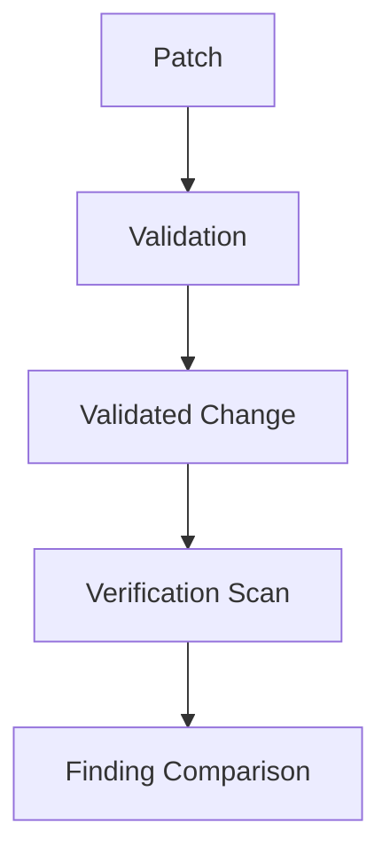

The verification scan determines whether the original finding remains present.

---

## 16. Verification Outcomes

### Finding resolved

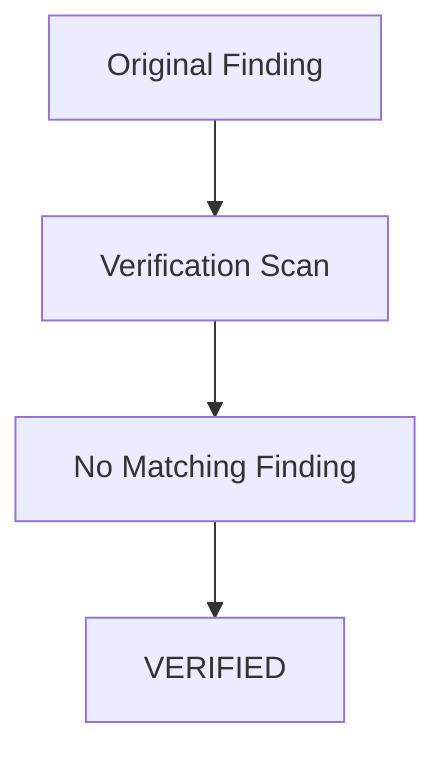

### Finding still present

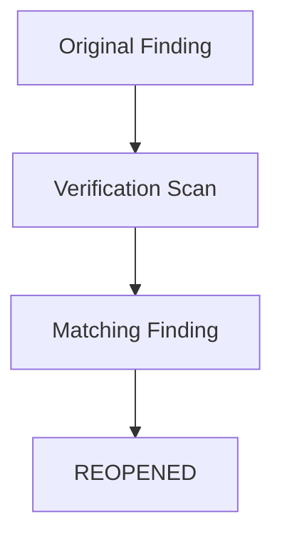

The finding must not be marked verified merely because a patch was generated or a test command succeeded.

---

## 17. Regression Detection

A remediation can introduce a different vulnerability, so verification and validation consider the broader security state.

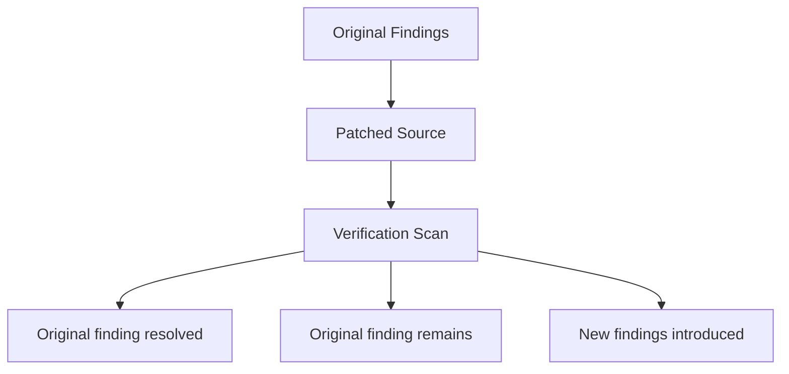

This preserves the distinction between fixing one issue and maintaining overall security posture.

---

## 18. Finding Lifecycle Integration

Remediation interacts with the finding lifecycle. The typical path:

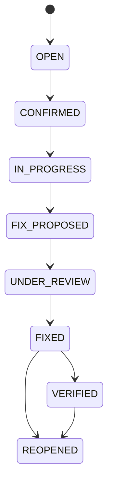

If verification discovers that the issue remains, the finding moves from `FIXED` or `VERIFIED` to `REOPENED`.

State transitions are controlled by backend lifecycle logic.

---

## 19. AI Safety

AI-generated remediation is treated as untrusted output. The system must not allow generated content to:

- Establish verified state
- Bypass authorization
- Execute arbitrary commands directly
- Modify production systems automatically
- Expose application secrets
- Override deterministic security evidence

Generated content must pass through application-controlled validation and review.

---

## 20. Prompt Safety

External or repository-controlled text can contain malicious instructions. Repository content is therefore treated as data, not trusted instructions.

AI context should clearly separate the following layers, from most to least trusted:

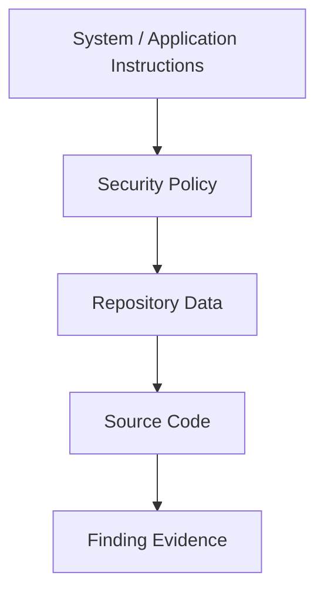

Repository text must not be allowed to redefine application instructions or authorization rules.

---

## 21. Provenance

Remediation and explanation records retain provenance. Relevant information includes:

- Provider
- Model
- Version
- Finding
- Source snapshot
- Generation time
- Validation result
- Verification scan

This makes AI-assisted security actions auditable.

---

## 22. Remediation API Boundary

The frontend communicates with the remediation API. The backend performs:

1. Authentication
2. Organization validation
3. Permission validation
4. Finding lookup
5. Evidence collection
6. Provider invocation
7. Remediation persistence
8. Lifecycle transition
9. Audit recording

The frontend never directly invokes model infrastructure.

---

## 23. Remediation Summary

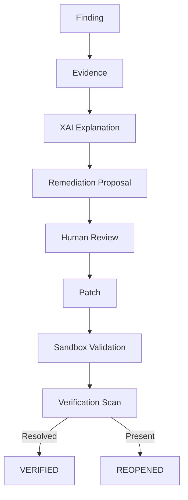

The goal is not merely to generate a patch. The goal is to establish whether the security issue was actually resolved.