# VulnScan Scanning Pipeline

## 1. Purpose

This document describes the VulnScan scanning pipeline from source acquisition through finding generation.

The pipeline is designed around immutable source snapshots, explicit stage state, deterministic evidence, AI-assisted analysis, correlation, and idempotent security results.

---

## 2. Pipeline Overview

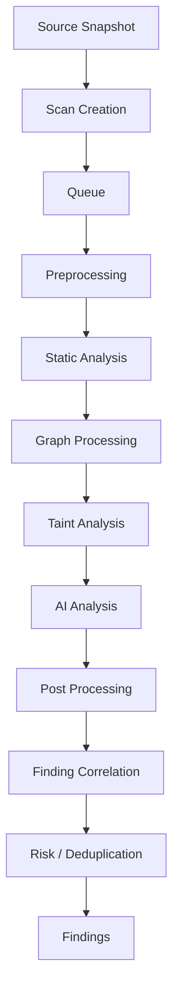

---

## 3. Source Boundary

Every scan is associated with an immutable source snapshot.

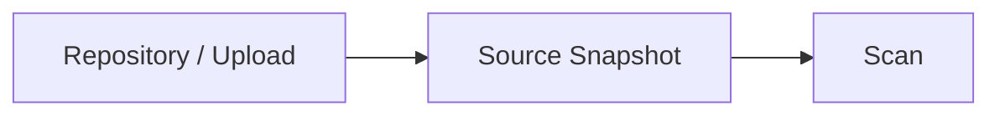

The scan does not analyze a mutable repository working directory as its historical source of truth.

---

## 4. Scan Creation

When a scan is created, the application records:

- Organization
- Project
- Source snapshot
- Scan configuration
- Scan purpose
- Creation metadata
- Initial lifecycle state

The API validates that:

1. The project belongs to the current organization.
2. The source snapshot belongs to the project.
3. The requesting user has scan permission.
4. The requested configuration is valid.

---

## 5. Queueing

The API creates the scan and submits background work.

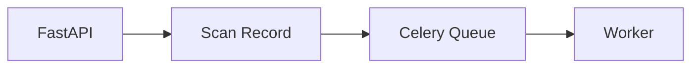

The API request does not perform the complete analysis synchronously.

---

## 6. Scan Orchestrator

The scan orchestrator controls stage execution. Responsibilities include:

- Stage ordering
- Stage state
- Worker heartbeat
- Failure handling
- Timeout handling
- Cancellation
- Retry-safe execution
- Scan completion
- Error recording
- Cleanup

---

## 7. Stage Lifecycle

Each stage follows a controlled lifecycle.

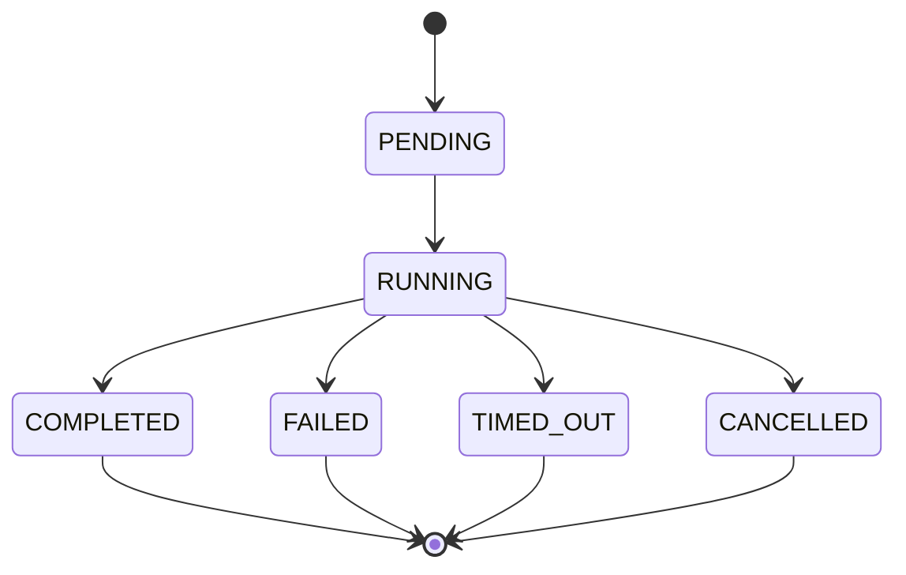

Unsupported capabilities are recorded explicitly as unsupported rather than completed.

---

## 8. Stage 1: Preprocessing

Preprocessing prepares the immutable source for downstream analysis. Tasks include:

- Language detection
- Source validation
- Function extraction
- Tokenization
- Identifier normalization
- Optional comment handling
- Duplicate-function detection
- Function metadata generation

The original source is never replaced.

---

## 9. Stage 2: Static Analysis

Static analysis operates on the snapshot and produces deterministic program evidence. Potential outputs:

- AST
- CFG
- CPG
- Call graph
- Data flow
- Pointer analysis
- Complexity
- API usage

The available set depends on the configured analysis engine.

---

## 10. Graph Artifacts

Graph outputs are represented using canonical artifact metadata:

- `graph_artifact_id`
- `source_snapshot_id`
- `graph_type`
- `schema_version`
- `artifact_uri`
- `checksum`
- `node_count`
- `edge_count`

Graph artifacts are stored outside the main relational database when appropriate.

---

## 11. Analysis Engine Boundary

VulnScan can integrate with an external graph or static-analysis engine such as Joern.

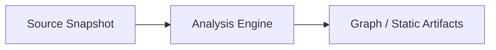

If the configured analysis engine is unavailable, the pipeline records the actual state. It does not fabricate external-analysis output.

---

## 12. Stage 3: Graph Processing

Graph processing consumes available graph artifacts. The graph pipeline can construct or consume representations such as:

- AST
- CFG
- CPG
- Call graph
- Data flow
- PDG (where supported)

The resulting graph data becomes input to downstream graph analysis and AI adapters.

---

## 13. Stage 4: Taint Analysis

Taint analysis identifies potentially dangerous source-to-sink flows.

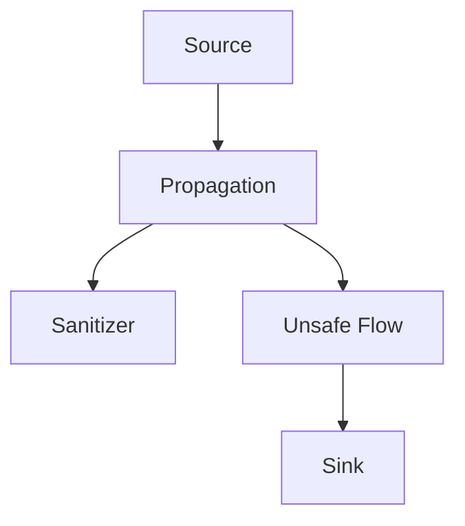

Taint evidence contains information such as:

- Source
- Sink
- Propagation path
- Sanitizer information
- Source location
- Sink location
- Graph references

A taint result is evidence, not an automatic vulnerability verdict.

---

## 14. Stage 5: AI Analysis

AI analysis consumes structured source and analysis context.

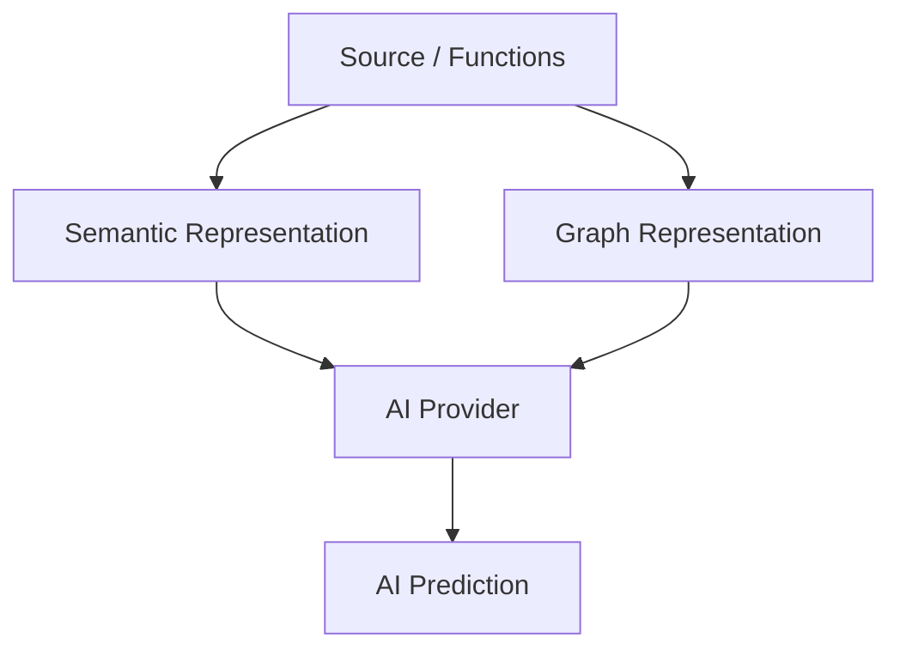

Predictions can contain:

- Vulnerability classification
- Confidence
- CWE
- Severity
- CVSS information
- Source location
- Function
- Model
- Model version
- Provider
- Evidence references

---

## 15. AI Provider Contract

AI implementations are hidden behind a stable provider boundary. The scan pipeline should not depend on:

- A specific neural architecture
- A specific checkpoint
- A specific inference runtime
- A specific model vendor

The provider returns canonical application-level prediction data.

---

## 16. Stage 6: Correlation

The correlation stage combines deterministic and AI signals.

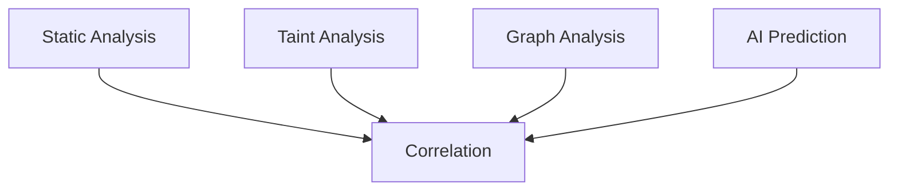

Correlation considers:

- Source location
- Function
- Vulnerability type
- CWE
- Severity
- Confidence
- Evidence
- Reachability and risk context

---

## 17. Fingerprinting

A fingerprint identifies the logical security issue. It is derived from stable finding characteristics rather than scan identity.

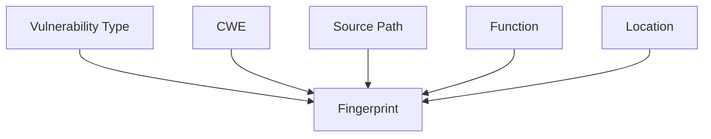

The exact fingerprint implementation is owned by the finding service.

---

## 18. Deduplication

Repeated scans should not create duplicate persistent findings for the same logical issue.

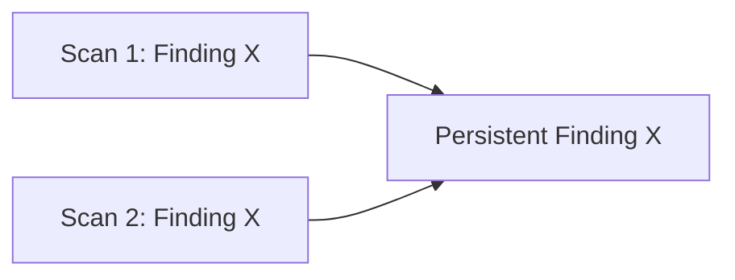

The later occurrence is associated with the existing finding.

---

## 19. Risk Calculation

Risk is calculated from normalized security information. Relevant inputs may include:

- CVSS
- AI confidence
- Reachability
- Severity
- Other normalized risk signals

The calculation is versioned so that changes to the risk model remain traceable.

---

## 20. Persistent Finding

The pipeline produces the persistent security finding.

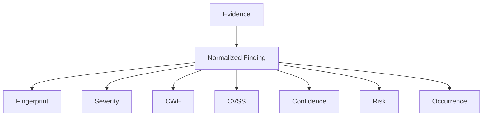

---

## 21. Scan Completion

A scan is completed only after the required pipeline stages finish successfully or reach an explicit terminal state.

The final scan state must accurately represent:

- Success
- Failure
- Cancellation
- Timeout
- Unsupported stage
- Partial execution, where applicable

---

## 22. Failure Handling

Possible failures include:

- Invalid source
- Extraction failure
- Preprocessing failure
- Analysis-engine failure
- Graph-processing failure
- Taint failure
- AI provider failure
- Database failure
- Object-storage failure
- Worker interruption

The system records the actual failure rather than converting it into a successful result.

---

## 23. Retry and Idempotency

Retryable work must be safe to repeat. Important rules:

1. Do not create duplicate persistent findings.
2. Do not create duplicate artifact records for the same immutable artifact.
3. Do not incorrectly advance a failed scan.
4. Do not lose the original failure information.
5. Do not associate results with a different source snapshot.

---

## 24. Cancellation

A running scan can be cancelled through the scan control API when permitted.

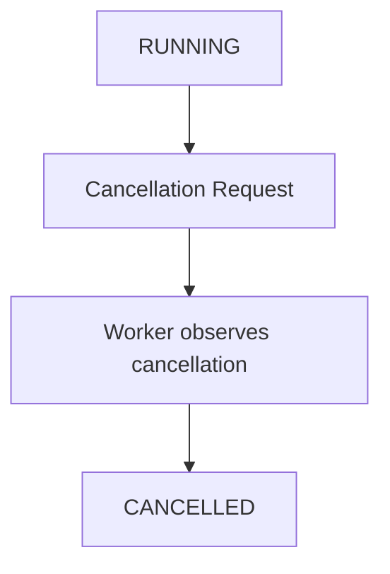

Cancellation must not leave the scan falsely marked as completed.

---

## 25. Timeout Handling

Long-running stages are bounded. When a stage exceeds its permitted execution time:

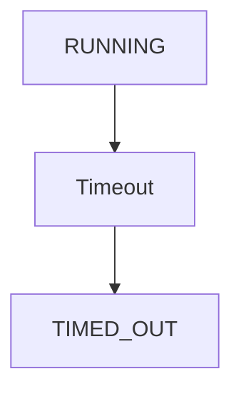

The timeout should be visible to the user and recorded for diagnostics.

---

## 26. Heartbeats

Workers update execution state while long-running stages are active. This allows the system to distinguish:

- Active work
- Stale work
- Failed workers
- Completed stages

Stale scans can be recovered instead of remaining indefinitely in a running state.

---

## 27. Artifact Integrity

Artifacts are associated with checksums. This applies to relevant:

- Source artifacts
- Graph artifacts
- XAI artifacts
- Reports
- Other generated security artifacts

The checksum provides an integrity reference for the stored object.

---

## 28. Security Boundary

Source code is untrusted input. The scanning pipeline must defend against:

- Path traversal
- Malformed archives
- Oversized archives
- Excessive file counts
- Null bytes
- Unsafe symlinks
- Unexpected command execution
- Resource exhaustion

Untrusted source must not be executed inside the FastAPI request process.

---

## 29. Pipeline Invariants

The scanning pipeline must preserve:

1. Immutable source snapshots
2. Organization ownership
3. Scan-to-snapshot association
4. Explicit stage state
5. Artifact integrity
6. Finding deduplication
7. AI provenance
8. Failure visibility
9. Cancellation correctness
10. Retry safety
11. Tenant isolation
12. Authoritative finding persistence

---

## 30. Pipeline Summary

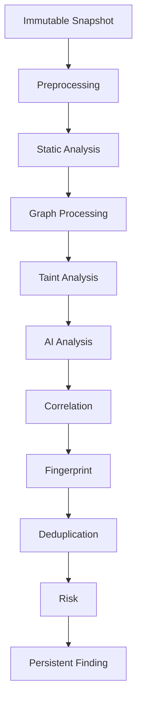

The scanning pipeline is the central security-data production path in VulnScan.