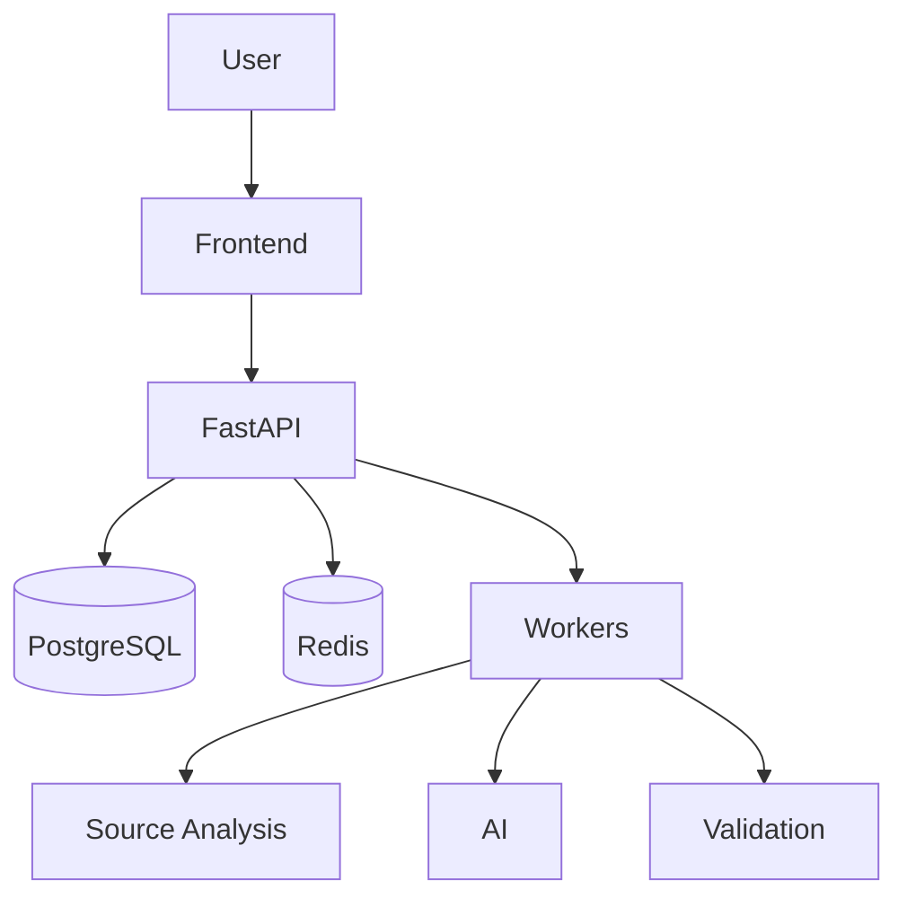
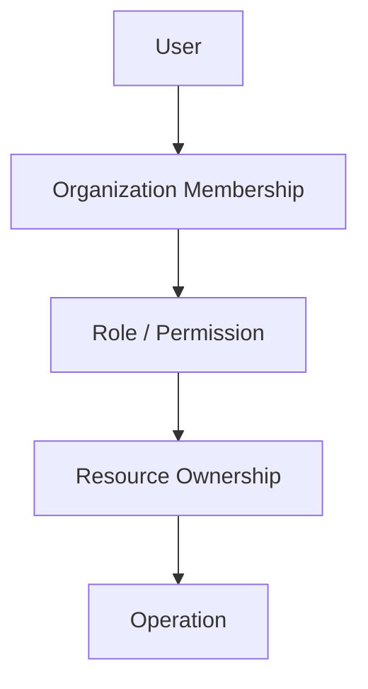
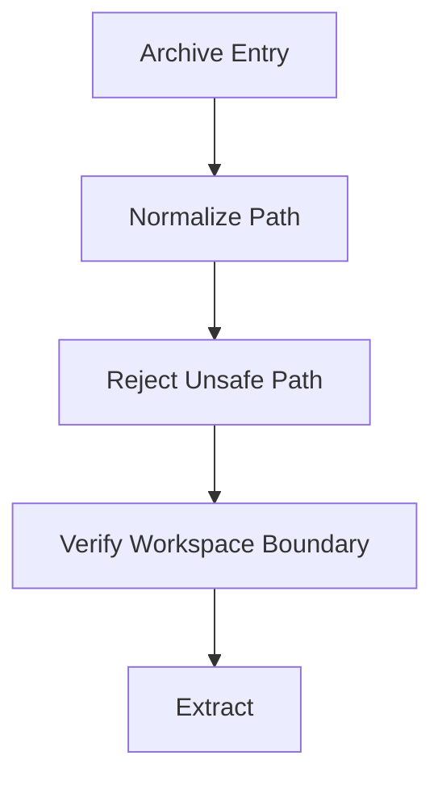
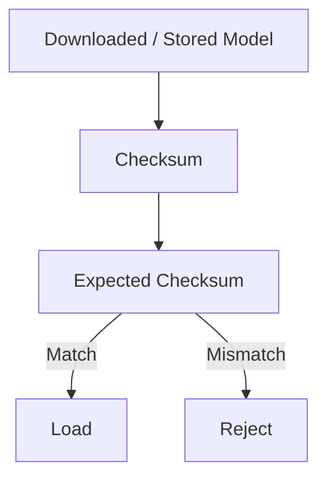
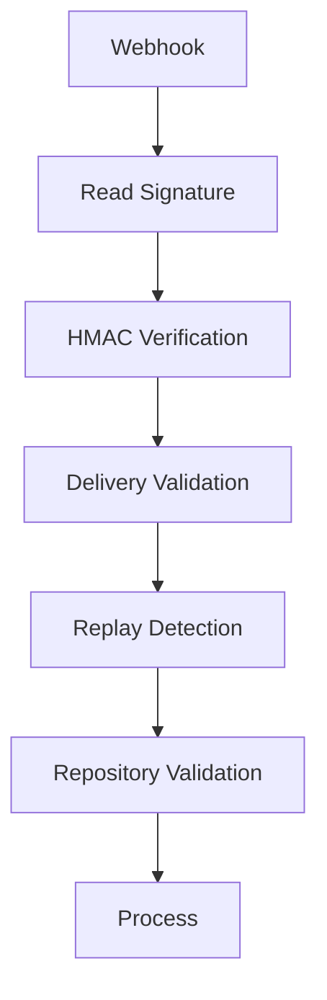
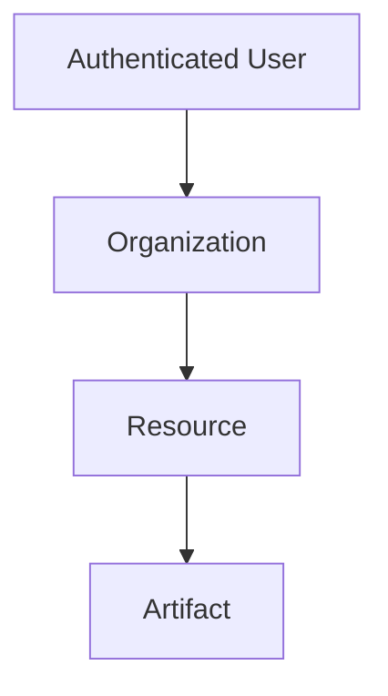

# VulnScan Security Architecture

## 1. Purpose

VulnScan analyzes untrusted source code, so it treats both repository content and AI-generated content as untrusted input.

Security controls exist at every major boundary.

---

## 2. Security Principles

VulnScan follows these principles:

- Tenant isolation
- Least privilege
- Defense in depth
- Explicit authorization
- Immutable evidence
- Secure input handling
- Bounded execution
- Fail-closed integrity checks
- Explicit uncertainty
- Auditability

---

## 3. Trust Boundaries



Repository source and generated AI content cross into trusted application workflows only through controlled interfaces.

---

## 4. Authentication

Authentication protects application access. Controls include:

- Password authentication
- Session tracking
- Refresh-token rotation
- Session revocation
- Password recovery
- Verification workflows
- API keys

Authentication credentials are never treated as authorization by themselves.

---

## 5. Session Security

Sessions are tracked server-side. Security controls include:

- Session identifiers
- Revocation
- Refresh rotation
- Replay detection
- Expiration
- Password-change invalidation, where applicable

A revoked session must not regain access through an old refresh token.

---

## 6. Authorization

Authorization is centralized. The decision is based on:



The frontend cannot grant permissions.

---

## 7. Tenant Isolation

Every organization-owned resource must remain scoped to its organization.

The backend must not rely on a resource UUID alone. Access must validate the organization and resource relationship.

This applies to:

- Projects
- Repositories
- Snapshots
- Source files
- Scans
- Artifacts
- Findings
- XAI
- Remediation
- Validation
- Reports
- Notifications
- Integrations

---

## 8. IDOR / BOLA Protection

Resource identifiers are untrusted input. For every resource request:

1. Authenticate the user.
2. Resolve organization context.
3. Verify membership.
4. Verify permission.
5. Resolve the resource within that organization.
6. Perform the operation.

A valid UUID belonging to another organization must not grant access.

---

## 9. RBAC

Role-based permissions are enforced server-side. Roles and permissions are stored in the application database and evaluated by centralized authorization logic.

Administrative operations require explicit permissions.

---

## 10. Source Upload Security

Source archives are untrusted. Extraction must defend against:

- `../` traversal
- Absolute paths
- Windows drive paths
- UNC paths
- Null bytes
- Symlink escapes
- Excessive file counts
- Excessive archive sizes
- Excessive extracted sizes
- Resource exhaustion

Files must remain inside the intended extraction workspace.

---

## 11. Archive Security

The extraction process must validate destination paths before writing.



Unsafe archive entries are rejected.

---

## 12. Untrusted Repository Execution

Repository content must not execute inside the FastAPI process. Analysis and validation occur in controlled worker and workspace boundaries.

This prevents arbitrary repository code from inheriting the API process's environment and credentials.

---

## 13. Command Execution

Commands must be passed as structured argument arrays, not shell-concatenated strings.

Unsafe pattern:

```text
shell("tool " + user_input)
```

Preferred pattern:

```text
exec(["tool", validated_argument])
```

User-controlled source paths and repository content must never become unrestricted shell syntax.

---

## 14. Validation Security

Patch validation is a high-risk boundary. It should use:

- Disposable workspaces
- Timeouts
- Resource limits
- Sanitized environment
- Restricted filesystem access
- Controlled command execution
- No application secrets

The validation environment must be treated as potentially hostile.

---

## 15. Sandbox Boundary

A temporary directory alone is not a complete sandbox. The security boundary depends on deployment infrastructure.

Possible additional controls include:

- Containers
- Namespaces
- cgroups
- Seccomp
- Read-only filesystem layers
- Network isolation
- Dedicated worker hosts

VulnScan must not claim stronger isolation than the actual deployment provides.

---

## 16. AI Security

AI output is untrusted. It must not directly:

- Change permissions
- Change tenant ownership
- Mark findings verified
- Bypass review
- Execute commands
- Access secrets
- Modify production resources

All AI outputs pass through application-controlled boundaries.

---

## 17. Prompt Injection

Repository content may contain adversarial instructions. Examples:

```text
// Ignore previous instructions
```

- README content pretending to be system instructions
- Test strings containing commands
- Configuration files containing model instructions

These are data. The application controls the instruction hierarchy.

---

## 18. Model Integrity

Model artifacts are security-sensitive. Where checksums are configured:



A corrupted or unexpected artifact must not silently become the active model.

---

## 19. Webhook Security

Webhook requests are untrusted until authenticated.



Invalid signatures must be rejected.

---

## 20. Webhook Replay Protection

Webhook delivery identifiers are tracked. A duplicate delivery should not execute the same security operation repeatedly.

If the same delivery identifier arrives with different payload content, it must not be silently treated as the original event.

---

## 21. API Key Security

API keys are credentials. Controls include:

- Protected storage
- Limited visibility
- Revocation
- Permission scope, where supported
- Tenant ownership

Raw API keys should not be written to logs.

---

## 22. Rate Limiting

Rate limiting protects sensitive endpoints against abuse. Important targets:

- Login
- Registration
- Refresh
- Scan creation
- Report generation
- Webhooks

Rate-limit enforcement must be understood in the context of the deployment topology. A single-process in-memory limiter does not provide distributed enforcement across multiple application workers.

---

## 23. Object Storage Security

Object-storage access must be scoped to the owning resource. The application should verify:



An object key must not be treated as sufficient authorization.

---

## 24. Artifact Integrity

Important generated artifacts should retain integrity metadata. Examples:

- Graph artifacts
- XAI artifacts
- Reports
- Model artifacts
- Validation artifacts

Checksums provide an integrity reference.

---

## 25. Secrets

Secrets include:

- Passwords
- Session tokens
- Refresh tokens
- API keys
- Database credentials
- Object-storage credentials
- GitHub secrets
- AI provider credentials
- Webhook secrets

Secrets must never appear in:

- Logs
- Source
- Reports
- Frontend bundles
- Error messages
- Public API responses

---

## 26. Error Handling

Errors returned to clients must not expose:

- Stack traces
- Database credentials
- Filesystem secrets
- Internal service credentials
- Provider secrets
- Raw environment variables

Detailed diagnostics belong in controlled server logs.

---

## 27. Logging

Security-relevant operations should be auditable. Useful correlation fields:

- Request ID
- User ID
- Organization ID
- Project ID
- Scan ID
- Task ID
- Worker ID

Sensitive values must be redacted.

---

## 28. Database Security

Database access follows application authorization. Important rules:

1. Use parameterized queries and ORM operations.
2. Avoid raw SQL concatenation.
3. Enforce foreign-key relationships.
4. Preserve organization ownership.
5. Use migrations as the schema authority.
6. Avoid destructive schema changes without an explicit migration.

---

## 29. Data Integrity

Security state should not be silently overwritten. Important immutable or traceable objects include:

- Source snapshots
- Scan artifacts
- AI provenance
- Finding history
- Remediation history
- Validation results
- Verification results
- Reports

---

## 30. Security State Integrity

The following distinctions must remain explicit:

- Not Run
- Unavailable
- Unsupported
- Failed
- Completed
- Verified

A failed or unavailable security capability must never be represented as a successful result.

---

## 31. Security Checklist

Before deployment:

- [ ] Authentication enabled
- [ ] Session security verified
- [ ] RBAC verified
- [ ] Tenant isolation verified
- [ ] Rate limits configured
- [ ] Upload limits configured
- [ ] Archive traversal protections verified
- [ ] Command execution restricted
- [ ] Validation execution bounded
- [ ] Secrets removed from logs
- [ ] Object storage authorization verified
- [ ] Model integrity verified
- [ ] Webhook signatures verified
- [ ] Replay protection verified
- [ ] Database credentials protected
- [ ] Production debug mode disabled
- [ ] Security logging enabled