# VulnScan System Flow

## 1. Purpose

This document explains how data moves through VulnScan, from the moment a user creates a project to the point where a vulnerability is investigated, remediated, validated, and verified.

The system is organized around one principle:

> Every security result must remain traceable to the source snapshot, analysis evidence, model provenance, and lifecycle operations that produced it.

---

## 2. High-Level Flow

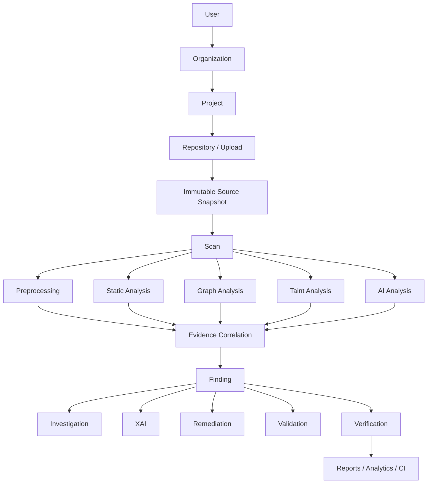

---

## 3. Organization Context

A user operates inside an organization. The organization determines:

- Which projects are visible
- Which repositories are accessible
- Which scans can be executed
- Which findings can be modified
- Which reports can be generated
- Which integrations can be configured
- Which administrative operations are permitted

Every organization-scoped API operation validates the current organization context.

---

## 4. Project Creation

A project establishes the main security-analysis boundary.

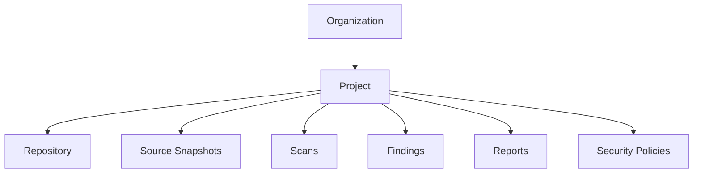

Projects are managed according to the user's organization permissions.

---

## 5. Repository and Source Ingestion

Source can enter the system through supported ingestion mechanisms.

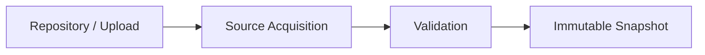

The original source is preserved. The system does not use a mutable working copy as the historical source of truth.

---

## 6. Immutable Source Snapshot

A snapshot represents the exact source state analyzed by a scan. It contains references to:

- Source files
- Functions
- Manifest information
- Integrity metadata
- Repository and commit information, where applicable

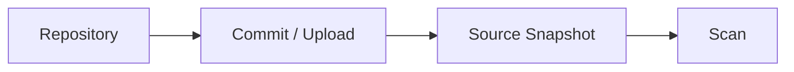

Historical scans therefore remain tied to the exact source state that was analyzed.

---

## 7. Preprocessing

The preprocessing stage prepares source for analysis.

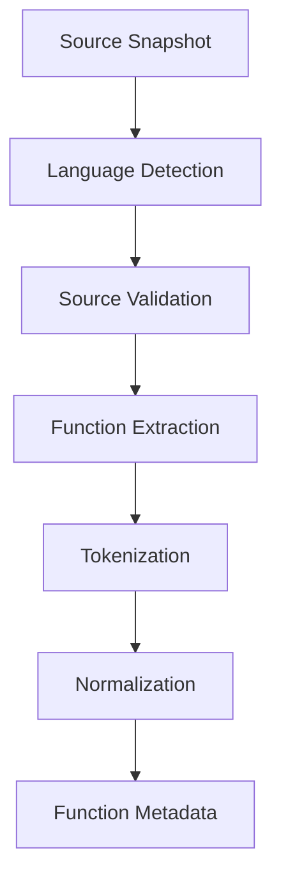

Preprocessing does not replace the original source. The original remains available for investigation and evidence display.

---

## 8. Scan Creation

A scan is created against a specific source snapshot. The scan records:

- Project
- Organization
- Source snapshot
- Configuration
- Creation time
- Current state
- Stage state
- Failure information
- Execution metadata

A scan never silently switches to another source snapshot.

---

## 9. Scan Execution

The scan is queued for background execution.

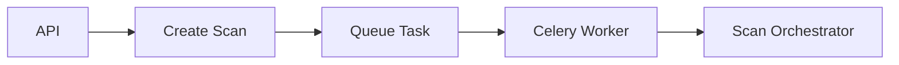

The orchestrator executes the configured stages in order.

---

## 10. Scan Stages

The analysis flow is conceptually:

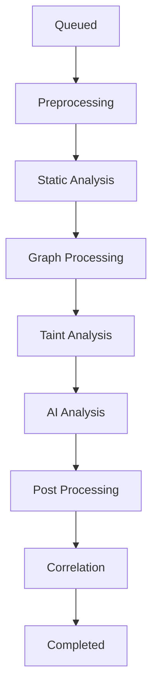

Every stage records its own execution state.

---

## 11. Static Analysis

Static analysis operates against the immutable snapshot. Possible outputs include:

- AST
- CFG
- CPG
- Call graph
- Data flow
- Pointer analysis
- Complexity
- API usage
- Taint information

The actual output depends on the configured analysis engine. If a capability is unavailable, the system records the corresponding state instead of fabricating an artifact.

---

## 12. Graph Processing

Graph processing transforms program structure into canonical graph artifacts.

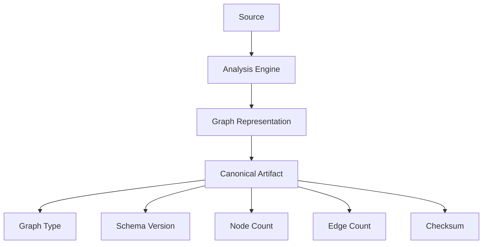

Downstream graph-processing and AI components can then consume the artifact.

---

## 13. Taint Analysis

Taint analysis identifies data flows between sources and sinks.

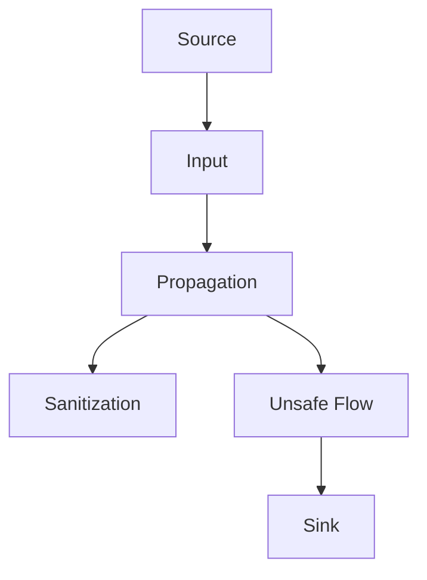

The result is stored as static evidence. A taint path alone is not equivalent to a confirmed vulnerability.

---

## 14. AI Analysis

AI inference operates after the deterministic analysis context is available.

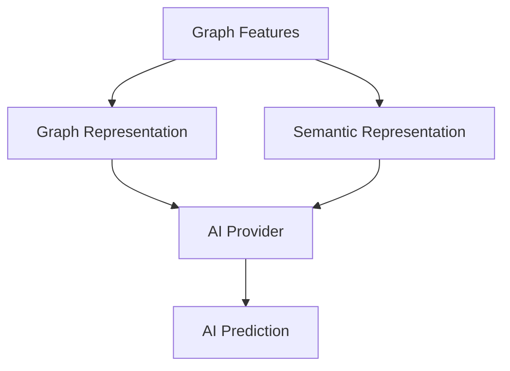

Predictions are stored with provenance:

- Provider
- Model
- Version
- Confidence
- Prediction type
- Source / function location
- CWE
- Severity
- CVSS information
- Evidence references

---

## 15. Evidence Correlation

The finding engine combines independent signals.

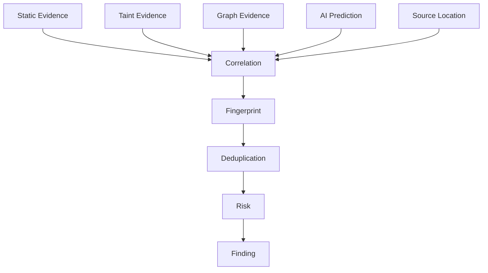

This prevents every individual analysis signal from becoming an independent vulnerability.

---

## 16. Finding Persistence

A finding is a persistent security-domain object. It can contain:

- Vulnerability classification
- CWE
- Severity
- CVSS
- Risk
- Confidence
- Source location
- Evidence
- Fingerprint
- Status
- Assignment
- Comments
- Suppression
- Risk acceptance
- Occurrences
- History

---

## 17. Finding Deduplication

Repeated scans are compared using finding fingerprints.

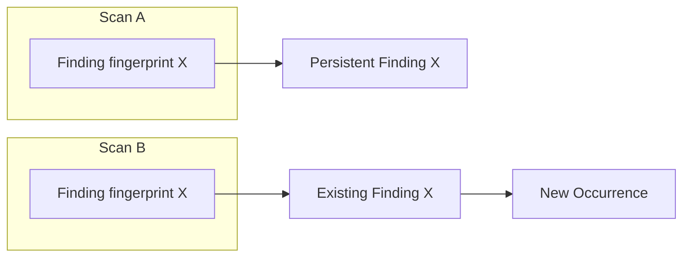

This keeps the finding domain stable across repeated scans.

---

## 18. Investigation

A user investigating a finding can move through:

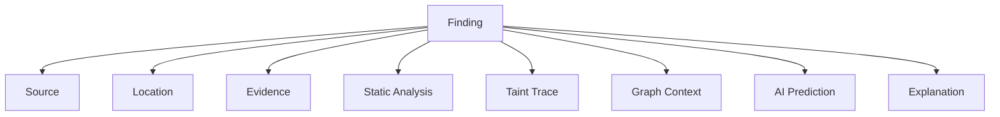

The source viewer references the immutable snapshot associated with the finding.

---

## 19. Explainability

XAI consumes the model and evidence context.

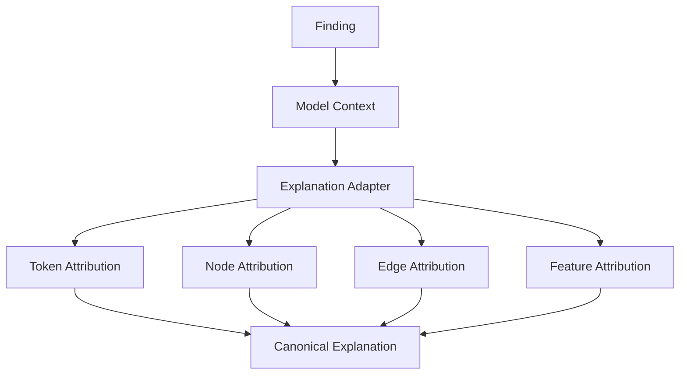

The UI presents the explanation together with the underlying security evidence.

---

## 20. Remediation

A user can request a remediation proposal.

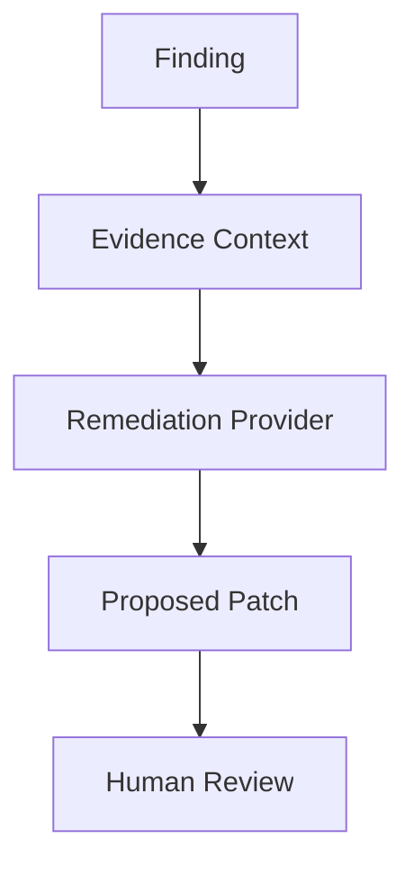

The patch remains a proposal until explicitly approved.

---

## 21. Patch Validation

Approved remediation is applied inside a disposable validation workspace.

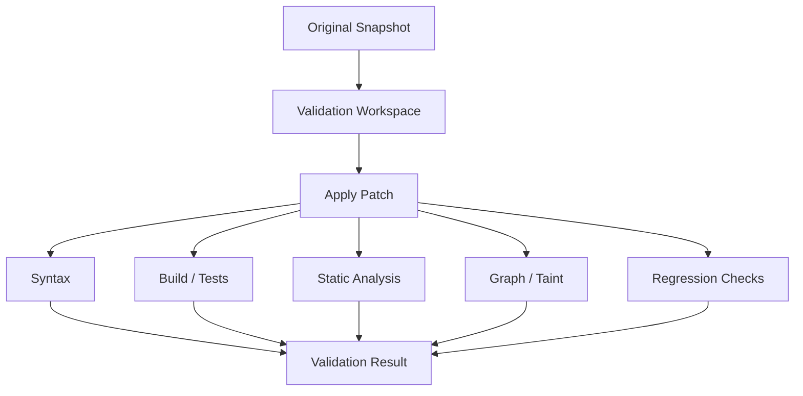

The validation environment is separated from the main API process.

---

## 22. Verification Scan

After validation, VulnScan can execute a verification scan.

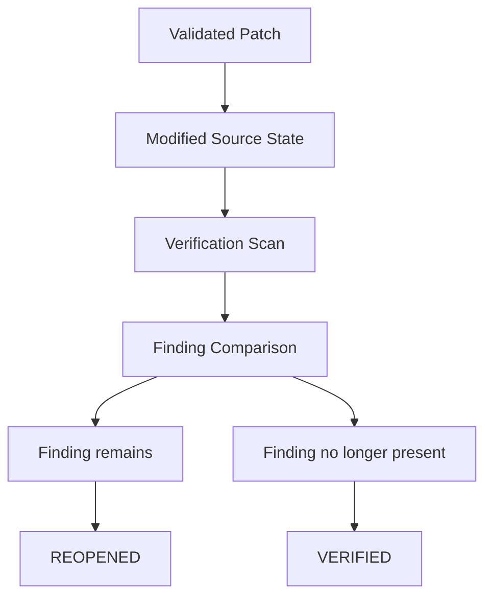

Verification is authoritative application state.

---

## 23. Reports

Reports consume persisted security information.

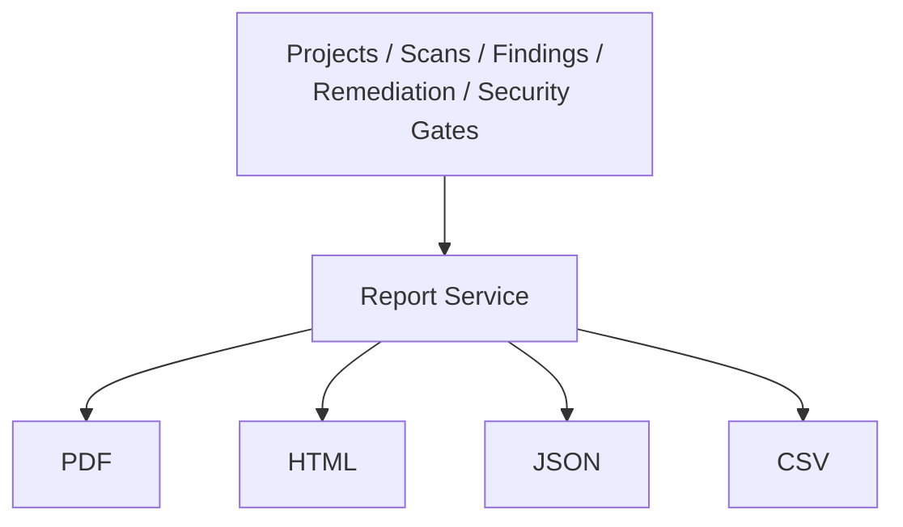

Generated report artifacts can be stored in object storage.

---

## 24. Analytics

Analytics consume the same underlying security domain. Examples include:

- Active projects
- Scan counts
- Finding counts
- Critical findings
- Top CWEs
- Security posture
- Severity distribution
- Historical security information, where supported

Analytics must reflect persisted security state.

---

## 25. Notifications

Notifications are generated from security-domain events. Examples include:

- Scan completion
- Critical findings
- Security gate failures
- Fix availability
- Fix validation
- Finding reopening
- Repository events
- Mentions

Notifications are scoped to the organization and user permissions.

---

## 26. GitHub Workflow

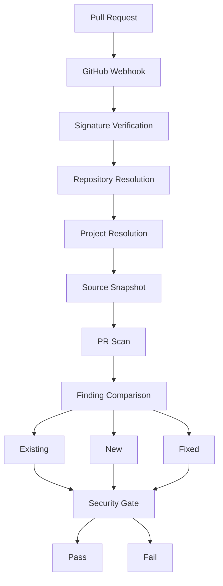

Webhook delivery identifiers and payload integrity are used to prevent duplicate or conflicting processing.

---

## 27. CI Workflow

CI clients interact with VulnScan through the supported API, CLI, and CI integration surface.

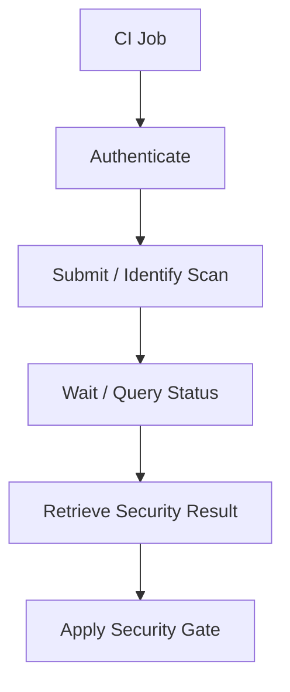

The CI system does not calculate the authoritative security state itself.

---

## 28. Failure Handling

Every major stage can fail. Examples include:

- Invalid source
- Repository failure
- Analysis-engine failure
- Taint failure
- AI provider failure
- Object-storage failure
- Worker interruption
- Validation failure
- Verification failure

Failures are represented explicitly. The system must never convert an error into a successful security result.

---

## 29. Cancellation and Timeout

Long-running operations support controlled cancellation and timeout behavior.

```mermaid
stateDiagram-v2
    [*] --> RUNNING
    RUNNING --> CANCELLED: Cancellation
    RUNNING --> TIMED_OUT: Timeout
    CANCELLED --> [*]
    TIMED_OUT --> [*]
```

Worker heartbeat information helps detect stale executions.

---

## 30. Complete Security Lifecycle

```mermaid
flowchart TD
    Org["Organization"] --> Project["Project"]
    Project --> Repo["Repository"]
    Repo --> Snap["Immutable Source Snapshot"]
    Snap --> Scan["Scan"]
    Scan --> Pre["Preprocessing"]
    Pre --> Static["Static Analysis"]
    Static --> GT["Graph / Taint Analysis"]
    GT --> AI["AI Analysis"]
    AI --> Corr["Evidence Correlation"]
    Corr --> Finding["Finding"]
    Finding --> Inv["Investigation"]
    Inv --> Exp["Explanation"]
    Exp --> Rem["Remediation"]
    Rem --> PV["Patch Validation"]
    PV --> VS["Verification Scan"]
    VS --> Verified["Verified Security State"]

    Verified --> Reports["Reports"]
    Verified --> Analytics["Analytics"]
    Verified --> Notif["Notifications"]
    Verified --> Gates["CI / GitHub Security Gates"]
```

---

## 31. Core Invariants

VulnScan maintains the following invariants:

1. A scan references an immutable source snapshot.
2. A finding remains associated with its organization and project.
3. AI predictions retain provenance.
4. Security evidence remains traceable to its source.
5. Duplicate findings are correlated through fingerprints.
6. Remediation does not automatically mean verification.
7. Validation does not automatically mean verification.
8. Unsupported analysis is not presented as successful analysis.
9. Cross-organization access is denied.
10. Backend authorization is authoritative.
11. Long-running work executes through workers.
12. Security-sensitive operations are auditable.